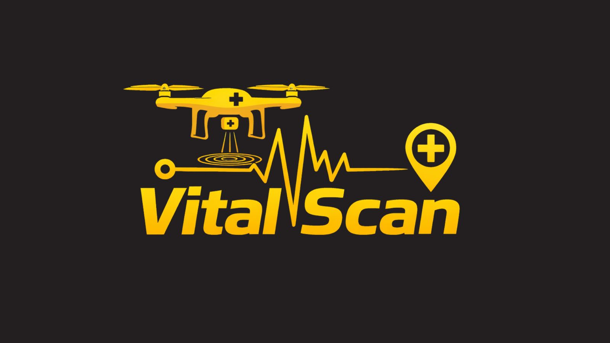
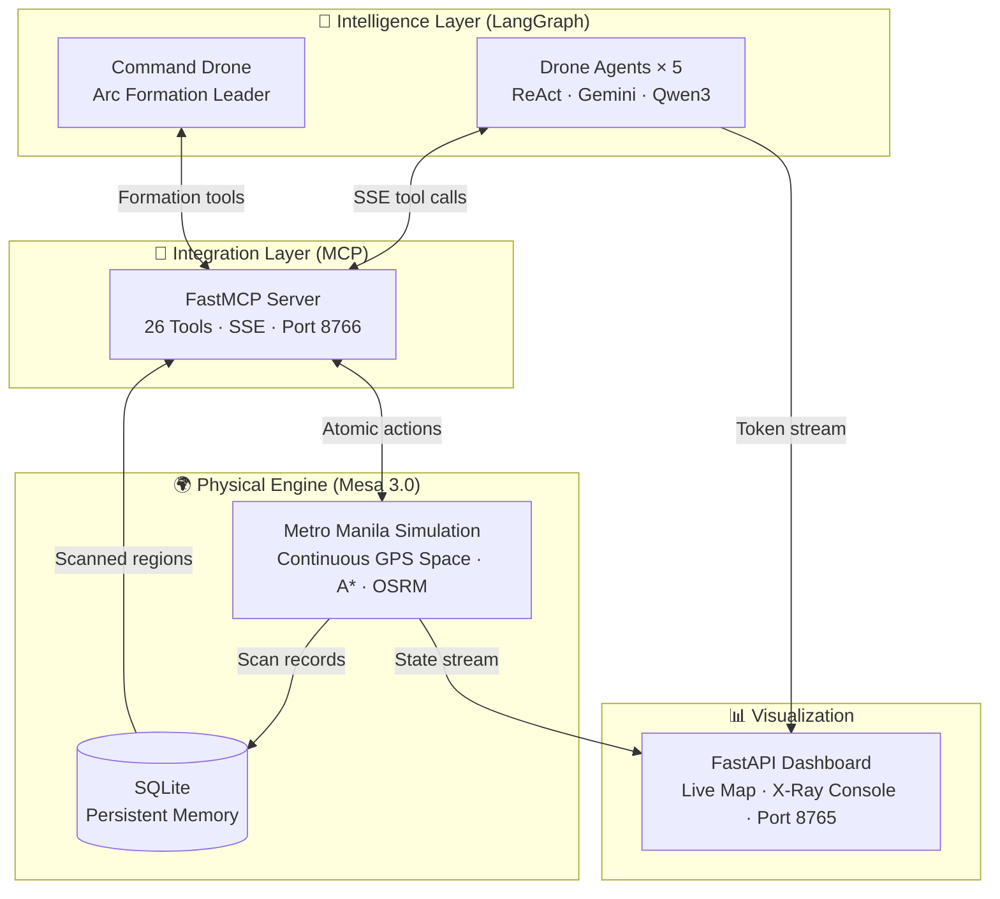

<div align="center">
  

  # 🚁 VITAL SCAN: Search & Rescue Swarm
  ### Next-Gen Autonomous Disaster Response via LangGraph & MCP

  <p align="center">
    <a href="https://www.python.org/"></a>
    <a href="https://fastapi.tiangolo.com/"></a>
    <a href="https://mesa.readthedocs.io/"></a>
    <a href="https://langchain-ai.github.io/langgraph/"></a>
  </p>

  <p align="center">
    
    
    
    
  </p>

  <p align="center">
    <a href="docs/zh/USER_GUIDE_ZH.md"><b>🇨🇳 中文文档 (Full Chinese Documentation)</b></a>
  </p>

  *Simulating an autonomous drone swarm conducting real-time SAR operations in the City of Manila.*
</div>

---

## 🏗️ System Architecture



---

## ✨ Features at a Glance

| Feature | Description |
| :--- | :--- |
| 🚀 **Autonomous Swarm** | 5 decentralized drones powered by LangGraph ReAct agents with real-time thought streaming |
| 🎖️ **Command Drone** | Formation leader navigates arc waypoints and monitors ring-swap events across the fleet |
| 📍 **Precision Physics** | A\* pathfinding, OSRM street routing, and dynamic events (Earthquake protocol & System malfunctions) |
| 🌍 **3D City Interface** | High-performance MapLibre OSM native 3D visualization with cinematic building extrusions |
| 📡 **MCP Standard** | 26 clean tool definitions via FastMCP — strict separation of AI logic from physics engine |
| 🔬 **Tactical Command Center** | Watch the LLM pipeline live, manage Critical Anomalies, and issue Force Recalls directly from the UI |
| 💾 **Persistence** | SQLite-backed scan memory survives restarts — eliminates LLM amnesia on long missions |

---

## 🛠️ Tech Stack

<div align="center">
  <table>
    <tr>
      <td align="center" width="140">
        <br />
        <b>Python 3.13</b><br/>
        <sub>Core Engine</sub>
      </td>
      <td align="center" width="140">
        <br />
        <b>FastAPI</b><br/>
        <sub>Dashboard & API</sub>
      </td>
      <td align="center" width="140">
        <br />
        <b>SQLite</b><br/>
        <sub>Persistence</sub>
      </td>
      <td align="center" width="140">
        <br />
        <b>Docker</b><br/>
        <sub>Deployment</sub>
      </td>
      <td align="center" width="140">
        <br />
        <b>Gemini AI</b><br/>
        <sub>LLM Cloud</sub>
      </td>
    </tr>
  </table>
</div>

---

## 🚀 Quick Start

```bash
# 1. Install dependencies
pip install -r requirements.txt

# 2. Set your Gemini API key
export GOOGLE_API_KEY='your-key-here'

# 3. Run
python main.py --models gemini-2.5-flash
```

Then open **http://localhost:8765**, place drones & survivors on the map, and click **▶ START MISSION**.

> **No Gemini key?** Use a local model: `python main.py --models gemma4:e4b`
> See [docs/SETUP.md](docs/SETUP.md) for full installation instructions.

---

## 📚 Documentation Directory

The project documentation has been cleanly compiled into three comprehensive master manuals:

| Master Manual | Description |
| :--- | :--- |
| **[🚀 USER GUIDE](docs/USER_GUIDE.md)** | Getting started, full installation paths (Local/Docker), troubleshooting, and glossary. |
| **[🧠 AI AGENT MANUAL](docs/AI_AGENT_MANUAL.md)** | System prompts, composite vs atomic skill charts, engineering techniques, and hierarchy. |
| **[🏗️ SYSTEM ARCHITECTURE](docs/SYSTEM_ARCHITECTURE.md)** | Low-level physics engine specs, tech stack deep dive, and the 26 FastMCP tool definitions. |

*See the [CHANGELOG](docs/CHANGELOG.md) for version release history.*

---

## 🗺️ Project Roadmap

- [x] **v1.0** — Core drone movement, battery math, Mesa simulation
- [x] **v1.1** — LangGraph ReAct agents, MCP server, live dashboard
- [x] **v1.2** — 3-2-1 arc formation, team sector sweep, X-Ray AI console
- [x] **v1.3** — 3D MapLibre city mapping, tactical command overrides, earthquake & drone fault protocols, gemma4 support
- [ ] **v1.4** — Multi-model dynamic switching (O1, Gemini, local LLMs)
- [ ] **v1.5** — Mobile PWA dashboard for field-ready monitoring

---

## 🤝 Contributing

1. **Fork** the repo
2. **Branch** — `git checkout -b feature/your-feature`
3. **Commit** — `git commit -m 'Add your feature'`
4. **Push** — `git push origin feature/your-feature`
5. **Pull Request** — open one against `main`

---

<div align="center">

  <kbd><b>🛰️ MISSION CONTROL CENTER</b></kbd>

  <br/><br/>

  <code><b>FLEET STATUS:</b> 🟢 OPERATIONAL</code> &nbsp;|&nbsp; <code><b>NODE:</b> MANILA_MAIN</code> &nbsp;|&nbsp; <code><b>UPTIME:</b> 99.9%</code>

  <br/><br/>

  <sub><b>METRO MANILA RESCUE v1.3.0</b><br/><i>"Non sibi sed aliis — Not for oneself, but for others"</i></sub>

  <br/><br/>

  

  <br/>
  <sub>Built with ❤️ for the SAR community</sub>

</div>
