<!-- Compiled Documentation: AI_AGENT_MANUAL.md -->

# 🤖 AI System Prompts — Logic & Philosophy

This document outlines the "Sense-Think-Act" loop used by the VitalScan drone swarm and details the exact logic provided to the AI models.

---

## 🔄 The Sense-Think-Act Loop

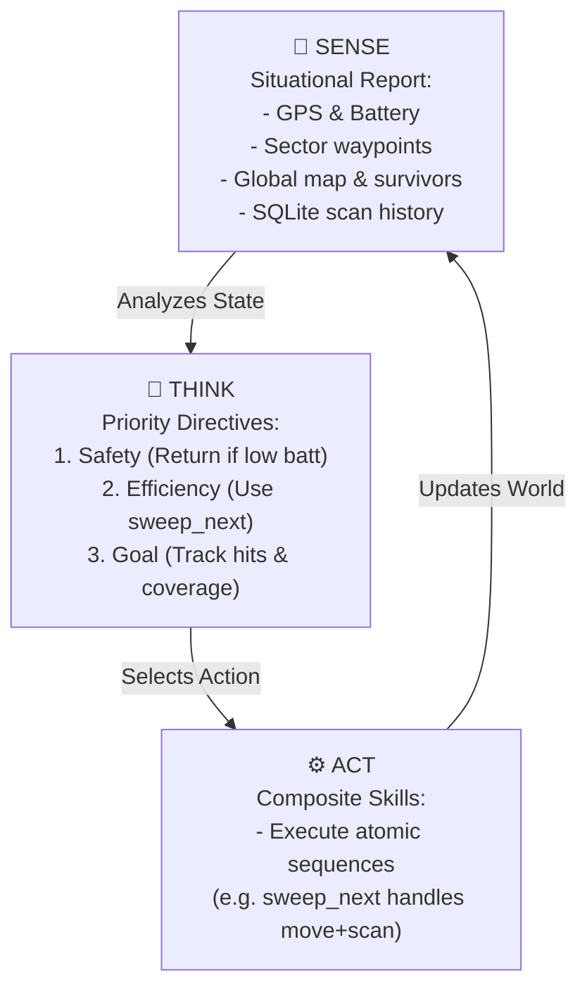

---

## 🎯 Core Systems & Directives

| System | Role / Identity | Primary Workflow | Core Directives & Focus |
|--------|-----------------|------------------|-------------------------|
| 🚁 **Drone Agent**  (*DRONE_ONSITE_SYSTEM*) | Direct field responder | Loop `sweep_next()` until sector is 100% mapped. | Format: Position `\|` Battery `\|` Survivors. |
| 🎖️ **Command Drone**  (*COMMANDER_SYSTEM*) | Formation supervisor | Route `safe_navigate()`, monitor via `fleet_overview()`. | Detect ring swaps; report fleet readiness. |
| 📐 **Fan Spread**  (*FAN_SPREAD_SYSTEM*) | Corridor coordination | Assign 2.0km → 0km depth slices per drone. | Center sweep on 1.0km disaster focal point; ensure zero gaps. |

---

## 📋 Best Practices for Modifying Prompts
1. **Be Terse**: AI models (especially smaller ones like Qwen) perform better with direct, non-conversational instructions.
2. **Use Markdown**: Structuring the prompt with `#` and `##` headers improves the model's intent recognition.
3. **Skill Priority**: Always mention the "Composite Skills" (the 8 high-level tools) first, as they are safer and more robust than raw atomic tools.

---

# 🛠️ AI Agent Skills
### Metro Manila Search & Rescue Swarm

---

## 🧠 Skill Classification Mindmap

Drones operate using a hierarchy of skills. **Atomic Skills** are direct commands to the physics engine, while **Composite Skills** bundle multiple actions into higher-level workflows.

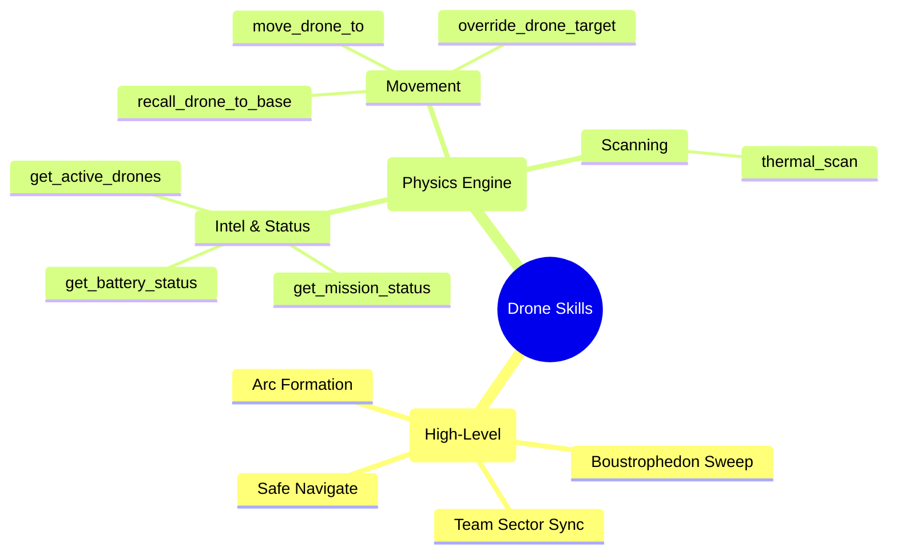

---

## ⚡ Composite Skills vs Atomic Skills

The AI should prioritize **Composite Skills** over chaining atomic commands manually. Composite skills reduce token usage and prevent hallucination by combining logic on the backend.

### Visualizing a Composite Skill: `sweep_next()`

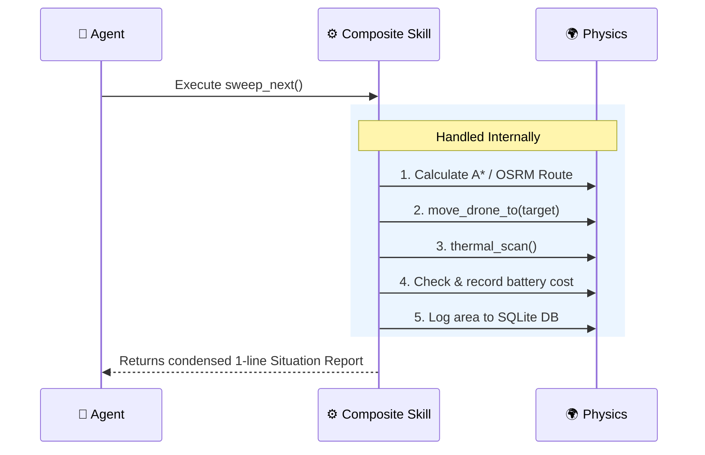

---

## 🧰 The Tactical Skill Matrix

| Category | Skill / Tool | Function | Threat / Cost |
|:---|:---|:---|:---|
| 🚁 **Flight** | `move_drone_to(x,y)` | Moves drone to specific GPS coordinates. | 🟡 `0.5% battery / km` |
| 🚁 **Flight** | `recall_drone_to_base()` | Emergency RTB for repairs or charging. | 🟢 Auto-charges at base |
| 🌡️ **Sensors** | `thermal_scan()` | Detects survivors within a 100m radius. | 🟢 Instant |
| 📊 **Intel** | `get_mapping_status()` | Retrieves global map completion percentage. | 🟢 Instant |
| 📊 **Intel** | `get_known_survivors()` | Pulls list of critical targets from SQLite. | 🟢 Instant |
| 👥 **Team** | `advance_team_sector()` | Progresses the entire 5-drone fleet to the next pie-slice. | 🔴 Blocks if team not ready |

---

## 🚨 Emergency Overrides (System Skills)

The following skills bypass the AI and are handled entirely by the backend environment. The AI cannot prevent them from occurring.

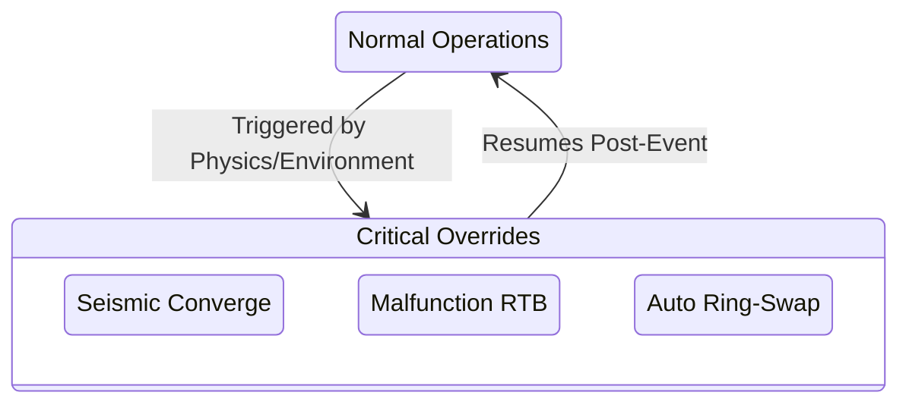

---

## 🔗 Skill to MCP Tool Mapping Flowcharts

Every high-level **Composite Skill** acts as a wrapper that automatically sequences multiple low-level **MCP Tools**. Here is how the agent skills map directly to the 26 exposed MCP tools.

### 1. Boustrophedon Sweep (Rescue Drone Primary Skill)
This skill automates the "lawnmower" search pattern. Instead of the AI calculating geometry, it simply loops this skill to process a sector.

**MCP Tools Consumed:** `get_team_waypoint` ➔ `move_drone_to` ➔ `thermal_scan` ➔ `advance_zone_waypoint`

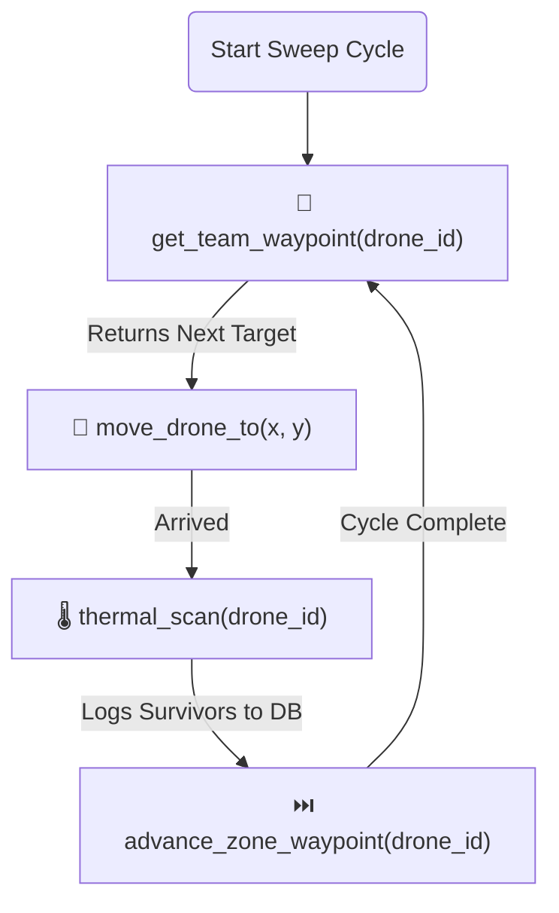

### 2. Team Sector Sync (Swarm Coordination Skill)
Ensures no single drone abandons its sector before the rest of the 5-drone formation finishes their slices.

**MCP Tools Consumed:** `get_team_sector_status` ➔ `get_active_drones` ➔ `advance_team_sector`

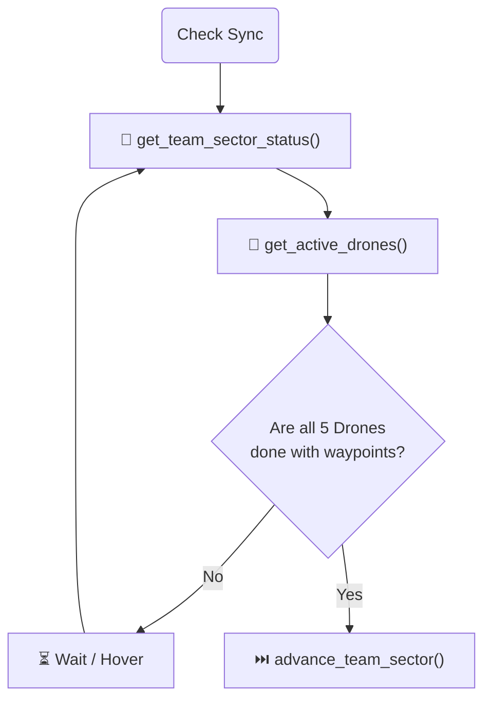

### 3. Arc Formation (Command Drone Navigation)
The CMD Drone uses this skill to fly its sweeping observational arc across the disaster zone without scanning for survivors.

**MCP Tools Consumed:** `get_arc_waypoints` ➔ `move_drone_to` ➔ `advance_arc_waypoint` ➔ `get_all_drones_status`

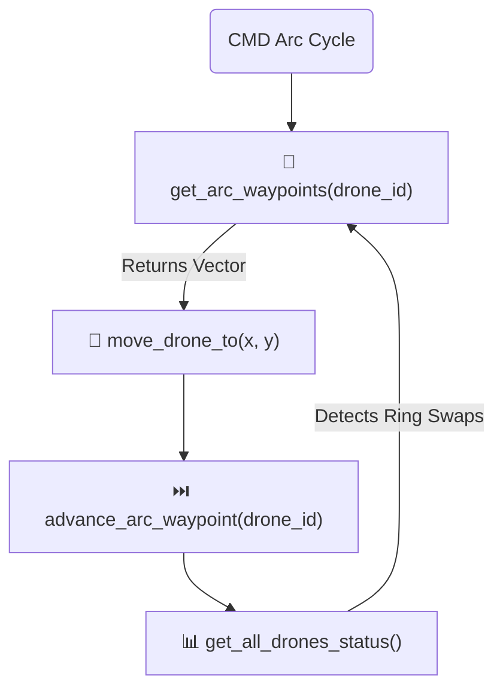

---

# 🎖️ Drone Swarm Hierarchy
### Command vs Rescue Drones Relationships

---

## 🧠 Fleet Chain of Command

The VitalScan Swarm utilizes a 1-to-5 decentralized command structure. While all agents are autonomous, their objectives and permissions differ heavily based on their assigned ring and role.

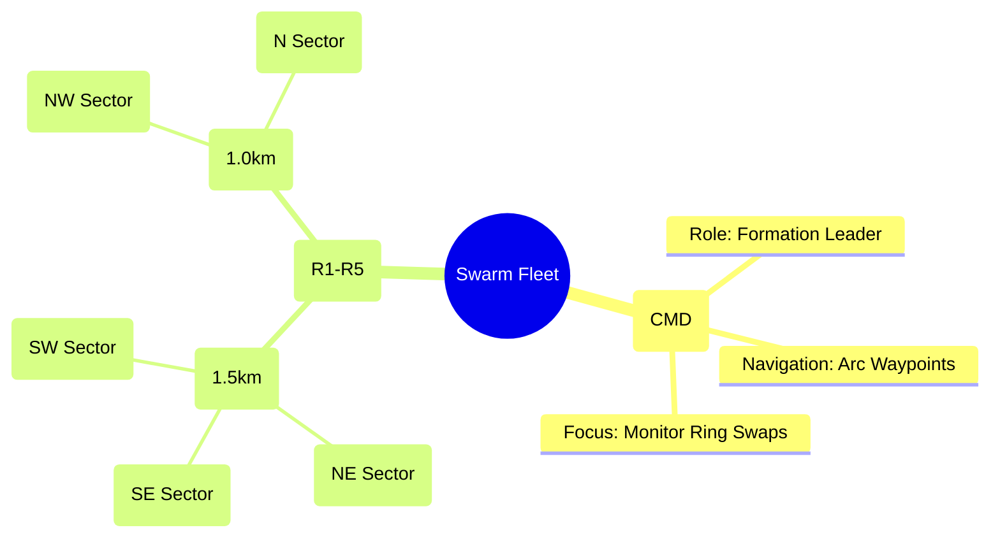

---

## 📡 Observation & Communication Flow

The CMD drone does **not** command the Rescue Drones directly. Instead, it observes their status via the `FastMCP` server. The Physics Engine inherently handles the promotions (Ring Swaps), while the CMD drone reports the holistic state to the dashboard.

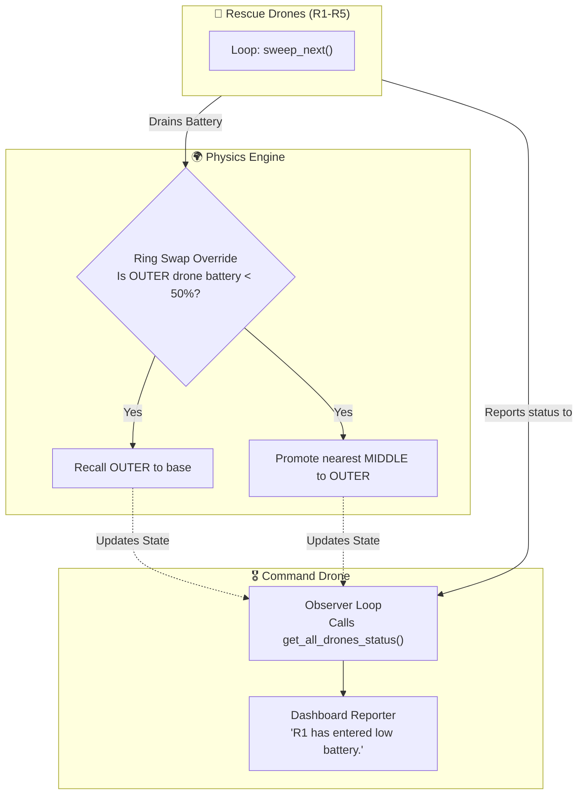

---

## ⚖️ Role Comparison

| Characteristic | 🎖️ Command Drone (CMD) | 🚁 Rescue Drones (R1-R5) |
| :--- | :--- | :--- |
| **Primary Mission** | Oversee fleet readiness & maintain arc formation. | Scan for survivors & map sectors. |
| **Search Responsibility** | **None.** Does not call `thermal_scan()`. | **Full.** Executes scans at every waypoint. |
| **Navigation Pattern** | Radial Arc Formations (`get_arc_waypoints`). | Sector Sweeps (`get_team_waypoint`). |
| **Battery Threshold** | RTB at `≤ 50%` (Recall Self). | RTB at `≤ 50%` (Automatically recalled by Physics). |
| **Response to Earthquakes**| Pauses for Seismic Survey. | Pauses for Seismic Survey & Converges. |

---

> **See also:** [ARCHITECTURE.md](ARCHITECTURE.md) for the full system loop.

---

# 🧠 AI Engineering Techniques
### Prompt, Context, and Harnessing Strategies in VitalScan

This document details the advanced LLM engineering techniques employed to transform standard text-generation models into highly autonomous, reliable rescue agents.

---

## 1. 📝 Prompt Engineering Skills

Prompt engineering in VitalScan focuses on constraining LLM hallucinations and forcing deterministic, actionable output.

### 🎯 Role-Playing & Persona Injection
Drones are given strict operational identities. We don't just ask the model to "route a drone"; we define its exact state within the swarm.
> *"You are rescue drone 21 — callsign R1. You are operating in Sector Alpha (0°–90°)."*

### 🔄 ReAct (Reasoning + Acting)
We utilize the LangGraph `create_react_agent` to enforce a strict chain-of-thought loop. The model is forced to output a `Thought` before making a `Tool Call`.

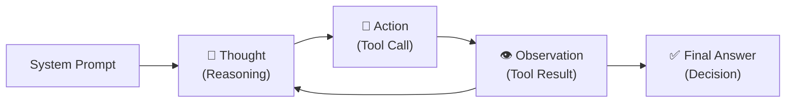

### 🧱 Markdown-Structured Directives
To help smaller models (like `qwen3:4b`) parse instructions, the system prompt heavily utilizes Markdown headers (`#`, `##`, `•`) rather than conversational paragraphs.

| Technique | Example | Benefit |
| :--- | :--- | :--- |
| **Negative Constraints** | `"Do NOT proceed if battery ≤ 20%"` | Prevents unsafe tool execution. |
| **Data Formatting** | `"Report in Position \| Battery \| Survivors format"` | Forces scannable, structured terminal outputs. |
| **Composite Priority** | `"Use sweep_next() instead of moving manually"` | Reduces token usage by bundling logic. |

---

## 2. 🗄️ Context Engineering Skills

Context engineering ensures the LLM has the exact data it needs to make a decision—without overflowing the context window.

### 💾 Persistent External Memory (SQLite)
LLMs suffer from context amnesia during long missions. Instead of putting the entire flight history in the context window, we save scans to `rescue_mission.db`.
- **How it works**: The LLM queries `get_scanned_areas_db()` to pull summarized, aggregated data about the map, keeping the active context window small and fresh.

### 📍 Dynamic Situational Injection
Before every decision, the LLM is injected with the most up-to-date telemetry. It doesn't need to "remember" where it is; it is told dynamically.

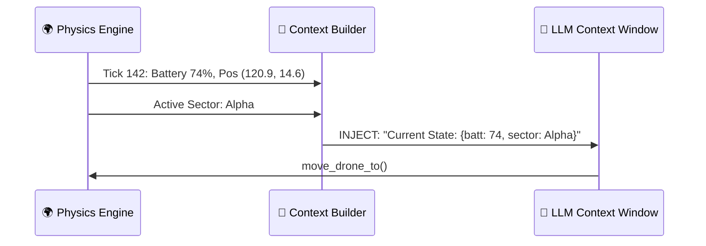

### 🛡️ Semantic Boundaries
We prevent hallucinations by denying context that doesn't belong to the drone. A drone in Sector Alpha cannot "see" the waypoints of Sector Delta, mathematically reducing the chance of cross-sector interference.

---

## 3. ⚙️ Harnessing Engineering Skills

Harnessing refers to how we physically bridge the non-deterministic LLM into the deterministic Python physics engine (Mesa).

### 🔌 Model Context Protocol (MCP)
Instead of relying on fragile string parsing, we use `FastMCP` to harness the model. The LLM interfaces with the physics engine strictly through JSON-schema validated Server-Sent Events (SSE). 
- If an LLM hallucinates an invalid coordinate, the MCP tool schema rejects it before it crashes the simulation.

### 🚦 Tool Interception & Graceful Failures
We never trust the LLM's tool calls blindly. Tools are harnessed with Python logic that returns natural-language errors back to the model, allowing it to self-correct.

| LLM Hallucination | Harness Interception | Result Sent to LLM |
| :--- | :--- | :--- |
| Tries to fly 5km with 10% battery | Physics layer calculates Haversine cost. | `"REFUSED: Battery critical. Execute recall_to_base()"` |
| Tries to scan outside its sector | Wrapper checks sector bounds. | `"ERROR: Target outside Sector Alpha boundaries."` |
| Tries to invent a tool `scan_all()` | MCP schema validator catches it. | `"ERROR: Tool not found. Available tools: thermal_scan..."` |

### 🔬 Telemetry Streaming (X-Ray Console)
To harness the reasoning of the AI for the human operator, we intercept the `StreamingCallback` of the LangGraph chain. Tokens are pushed word-by-word over WebSockets to the **Tactical Command Center**, allowing operators to monitor the AI's internal thoughts in real-time.

---

