<!-- Compiled Documentation: SYSTEM_ARCHITECTURE.md -->

<div align="center">

# 🏗️ System Architecture
### Metro Manila Search & Rescue Swarm

[](https://langchain-ai.github.io/langgraph/)
[](https://mesa.readthedocs.io)
[](https://github.com/jlowin/fastmcp)
[](https://fastapi.tiangolo.com)

**Related docs:** [TECH_STACK.md](TECH_STACK.md) ← deep-dive · [MCP_TOOLS.md](MCP_TOOLS.md) · [SETUP.md](SETUP.md) · [GLOSSARY.md](GLOSSARY.md)

</div>

---

## Full System Architecture

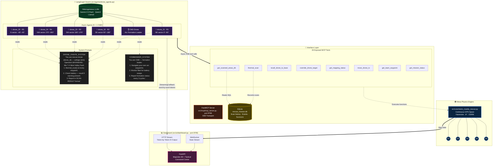

---

## Agent Prompt Logic

> **Visual Guide:** See **[DRONE_HIERARCHY.md](DRONE_HIERARCHY.md)** for a detailed mindmap and flowchart of the Command vs Rescue Drone relationships.

### 🚁 Drone Agent — `DRONE_ONSITE_SYSTEM`

Each rescue drone operates under a tactical field-report prompt. Logic executed at every waypoint:

```
1. SCAN       thermal_scan(drone_id)
              → count survivors, flag critical, detect clusters (3+ within 50 m)

2. ASSESS     How many found? Any critical cases? Cluster risk?

3. BATTERY    get_battery_status(drone_id)
              → If warning is present: report it, do NOT proceed to next waypoint

4. REPORT     Output in structured SCAN RESULT / BATTERY STATUS / ASSESSMENT format
```

**Battery swap rule:** If an OUTER drone (R1/R2/R3) drops to ≤ 50%, the simulation automatically recalls it and promotes the nearest MIDDLE drone to OUTER. The drone does **not** call `recall_drone_to_base` manually — the physics engine handles it.

**Earthquake & Malfunction Overrides:** The physics engine handles dynamic events independently from the AI. If an earthquake zone is entered, all drones freeze for a seismic survey, collectively converge using A*, and then return to their prior sweep coordinates. Additionally, a drone malfunction triggers at the 10th thermal scan—halting the drone and initiating an A* return-to-base for repair.

---

### 🎖️ Command Drone — `COMMANDER_SYSTEM`

The CMD drone does **no survivor scanning**. It flies its own arc waypoints and monitors the formation:

```
Every cycle:
  Step 1 → get_arc_waypoints(drone_id)       — get next arc position
  Step 2 → move_drone_to(drone_id, x, y)     — fly to it
  Step 3 → advance_arc_waypoint(drone_id)    — advance arc cursor
  Step 4 → get_all_drones_status()           — check for ring swaps (every 3 cycles)
  Step 5 → get_battery_status(drone_id)      — if ≤ 50%: recall self
```

---

## Live Streaming Architecture

The defining feature of this system is **real-time LLM thought streaming** — no waiting for complete responses.

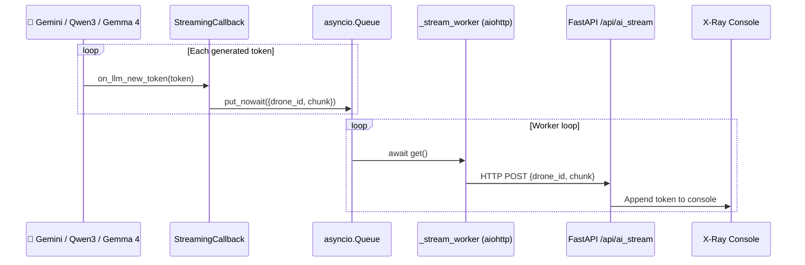

---

## Concurrency Model

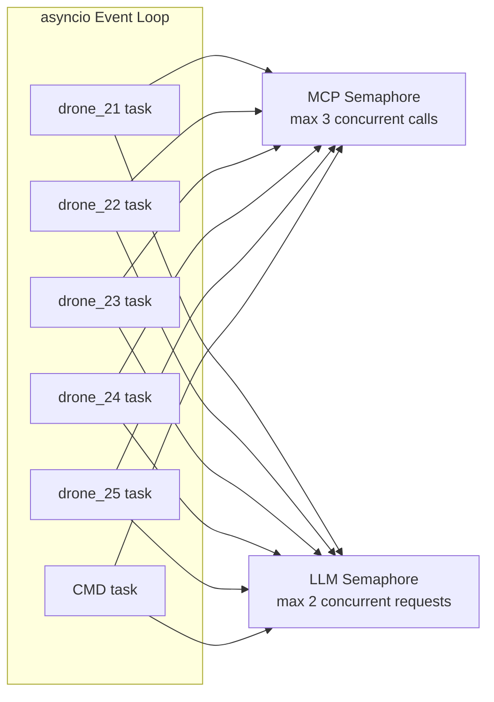

> Semaphores prevent connection exhaustion on both the Ollama local server and the MCP SSE endpoint.

---

## Component Summary

| Component | File | Port | Technology |
|-----------|------|------|-----------|
| Entry Point | `main.py` | — | argparse · subprocess · asyncio |
| MCP Server | `src/mcp/mcp_server.py` | 8766 | FastMCP · SSE · uvicorn |
| Simulation | `src/core/metro_manila_rescue.py` | — | Mesa 3.0 · A\* · OSRM · Haversine |
| Drone Agents | `src/agents/drone_agents.py` | — | LangGraph · LangChain · aiohttp |
| Dashboard | `src/ui/dashboard.py`, `dashboard_3d_recon.py` | 8765 | FastAPI · WebSocket · HTML5 |
| Database | `src/core/db.py` | — | SQLite (stdlib) |

---

> For a deep-dive into each technology, physics constants, and code-level details see **[TECH_STACK.md](TECH_STACK.md)**.
> For all 26 MCP tool definitions see **[MCP_TOOLS.md](MCP_TOOLS.md)**.
> To debug issues see **[TROUBLESHOOTING.md](TROUBLESHOOTING.md)**.


---

<div align="center">

# 🛰️ TECH STACK — DEEP DIVE
### Metro Manila Search & Rescue Swarm System
#### *Operation BAYANIHAN — Mw 7.4 West Valley Fault Response*

<br>

[](https://mesa.readthedocs.io)
[](https://langchain-ai.github.io/langgraph/)
[](https://github.com/jlowin/fastmcp)
[](https://ai.google.dev)
[](https://sqlite.org)
[](https://fastapi.tiangolo.com)
[](http://project-osrm.org)
[](https://docker.com)

</div>

---

**Related docs:** [ARCHITECTURE.md](ARCHITECTURE.md) ← overview · [MCP_TOOLS.md](MCP_TOOLS.md) · [SETUP.md](SETUP.md) · [GLOSSARY.md](GLOSSARY.md)

---

## 📋 Table of Contents

| # | Section |
|---|---------|
| 1 | [System Overview](#1-system-overview) |
| 2 | [Simulation Engine — Mesa 3.0](#2-simulation-engine--mesa-30) |
| 3 | [MCP Server — Tool Protocol](#3-mcp-server--tool-protocol) |
| 4 | [AI Agentic Framework — LangGraph](#4-ai-agentic-framework--langgraph) |
| 5 | [Persistence Layer — SQLite](#5-persistence-layer--sqlite) |
| 6 | [Live Dashboard — FastAPI](#6-live-dashboard--fastapi) |
| 7 | [Full System Data Flow](#7-full-system-data-flow) |

---

## 1. System Overview

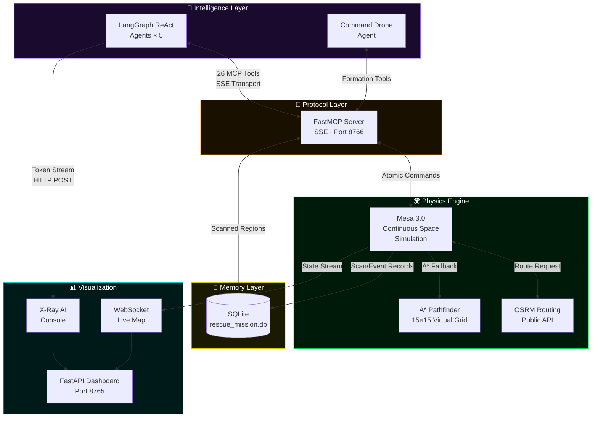

<div align="center">

| Layer | Technology | Role |
|-------|-----------|------|
| 🧠 Intelligence | LangGraph + Gemini / Qwen3 | Autonomous drone decision-making |
| 📡 Protocol | FastMCP + SSE | Tool exposure between AI and physics |
| 🌍 Physics | Mesa 3.0 + OSRM + A\* | Real-space simulation |
| 💾 Memory | SQLite | Persistent scan history |
| 📊 Visualization | FastAPI + WebSocket | Live map + AI console |

</div>

---

## 2. Simulation Engine — Mesa 3.0

> **File:** `src/core/metro_manila_rescue.py`

### 🗺️ What Is It?

Mesa is a Python **agent-based modelling** framework. Instead of global equations, each entity (drone, survivor) is an *independent agent* with its own state and `step()` function. Every simulation tick every agent acts.

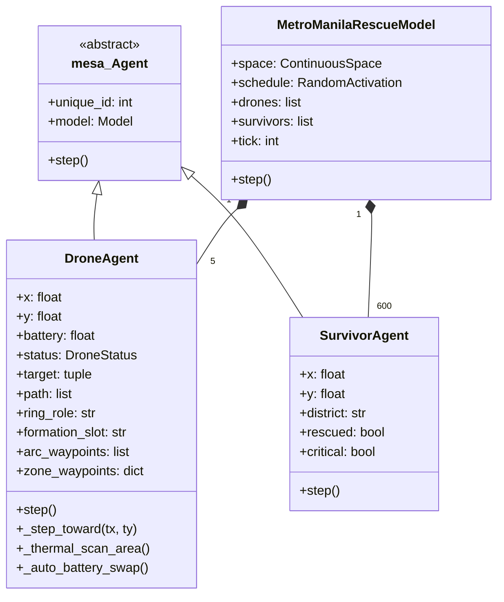

---

### 📐 Geographic Space

The simulation runs in **real GPS coordinates** — not a toy grid. Every position is an actual longitude/latitude point over the City of Manila.

```
Geographic Bounds (City of Manila)
─────────────────────────────────────────────────────
  SW Corner →  14.550°N, 120.950°E
  NE Corner →  14.630°N, 121.010°E
  Width     →  ≈ 6.0 km  (east–west)
  Height    →  ≈ 8.9 km  (north–south)
  Area      →  ≈ 53.4 km²
─────────────────────────────────────────────────────
```

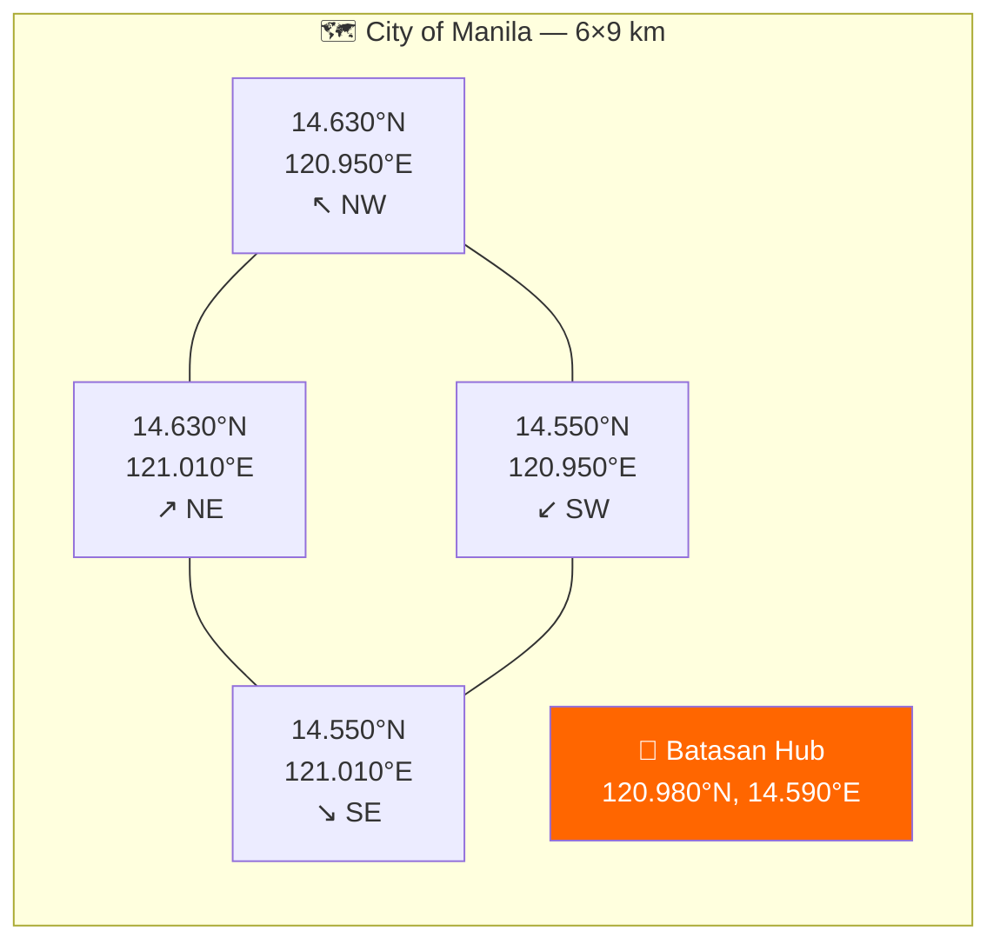

**Coordinate conversion constants (Manila latitude):**
```
_KM_PER_LAT = 111.0 km/°
_KM_PER_LNG = 111.0 × cos(14.59°) ≈ 107.4 km/°
```

---

### 🚁 Drone Agent — Physics Model

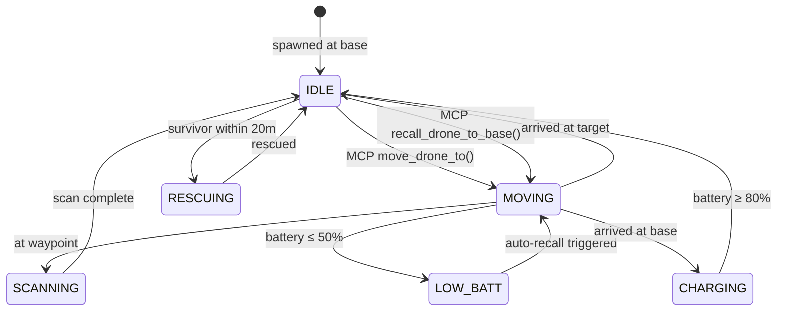

<div align="center">

| Physics Constant | Value | Meaning |
|-----------------|-------|---------|
| `SPEED_PER_TICK` | 0.05 km/tick | Forward speed per simulation step |
| `BATTERY_DRAIN` | 0.5 % per km | Energy cost of flight |
| `CHARGE_RATE` | 20 % per tick | Recharge speed at base station |
| `VISION_RADIUS` | 0.1 km (100 m) | Thermal scan radius |
| `LOW_BATTERY` | 50 % | Auto-recall trigger threshold |
| `NUM_DRONES` | 5 | Rescue drones in fleet |
| `NUM_SURVIVORS` | 600 | Survivors distributed across 2 km radius |
| `DISASTER_CELLS` | 30 | Collapsed building zones |

</div>

---

### 🧭 Pathfinding — Two-Tier Strategy

Drones don't teleport. They follow real computed paths using a two-tier pathfinding system:

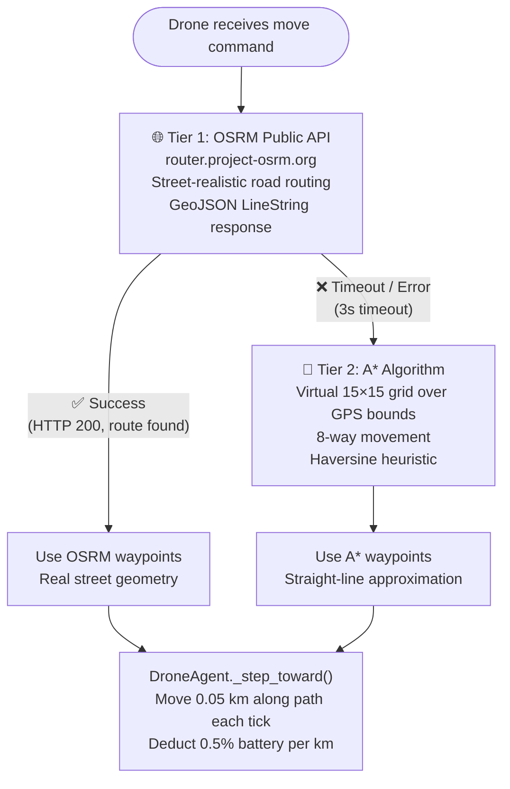

**OSRM API Call:**
```
GET http://router.project-osrm.org/route/v1/driving/
    {start_lng},{start_lat};{end_lng},{end_lat}
    ?steps=false&geometries=geojson&overview=full

Response: GeoJSON LineString → [(lng1,lat1), (lng2,lat2), ...]
```

**A\* on Virtual Grid:**
```
Grid size    : 15 × 15 cells over GEO_BOUNDS
Movement     : 8-directional (cardinal + diagonal)
Move cost    : 1.0 (cardinal), 1.414 (diagonal)
Heuristic    : Euclidean distance on grid cells
```

---

### 🏹 Formation Strategy — 3-2-1 Arc Rings

All 5 drones sweep in concentric arc rings, expanding outward from Batasan Complex Hub.

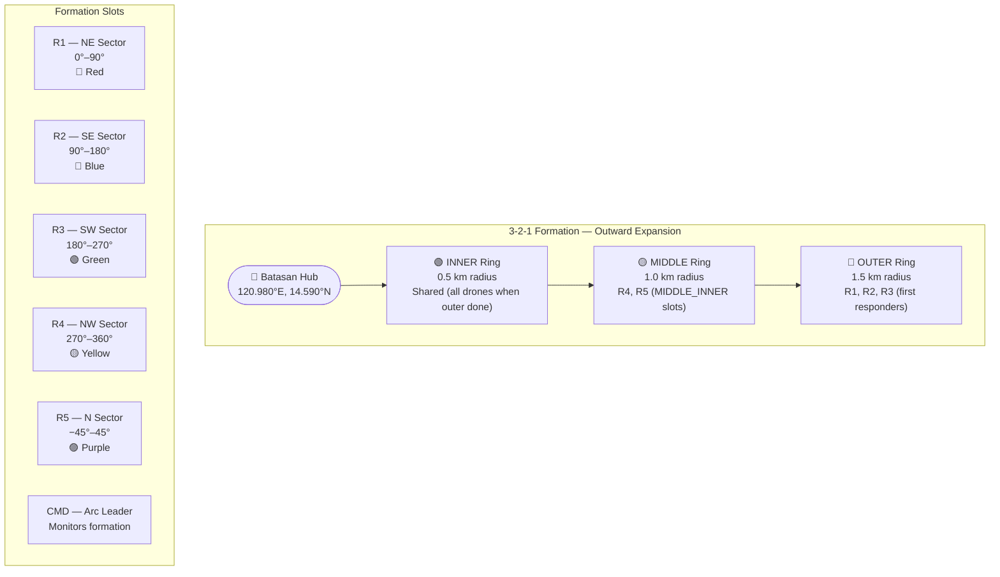

**Battery Swap Logic:**
```
If OUTER drone (R1/R2/R3) battery ≤ 50%:
  → Auto-recall to base
  → Promote nearest MIDDLE drone to OUTER ring
  → Reassign remaining outer waypoints to promoted drone
  → After recharge to 80%: reassigned as INNER
```

---

### 🍕 Team Sector Strategy — Pie-Slice Coverage

Alternative sweep mode: all 5 drones converge on **one sector at a time**, completing it before advancing.

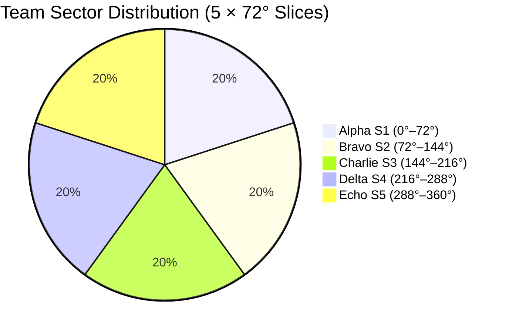

<div align="center">

| Sector | ID | Angle | Color | Role Split |
|--------|-----|-------|-------|-----------|
| Alpha | S1 | 0°–72° | 🟠 Orange | R1/R2/R3 → OUTER · R4/R5 → MIDDLE |
| Bravo | S2 | 72°–144° | 🔴 Red | R1/R2/R3 → OUTER · R4/R5 → MIDDLE |
| Charlie | S3 | 144°–216° | 🔵 Blue | R1/R2/R3 → OUTER · R4/R5 → MIDDLE |
| Delta | S4 | 216°–288° | 🟢 Green | R1/R2/R3 → OUTER · R4/R5 → MIDDLE |
| Echo | S5 | 288°–360° | 🟣 Purple | R1/R2/R3 → OUTER · R4/R5 → MIDDLE |

</div>

---

### 📐 Distance Formula — Haversine

All range calculations use the **Haversine formula** for accurate GPS distances on a spherical Earth:

```
R = 6371.0 km  (Earth radius)

a = sin²(Δlat/2) + cos(lat₁) · cos(lat₂) · sin²(Δlng/2)
c = 2 · atan2(√a, √(1−a))
d = R · c  [km]
```

> This replaces the naive Euclidean approximation and accounts for the Earth's curvature — critical at Manila's 14.6°N latitude.

---

### 🏢 Base Stations

<div align="center">

| Hub | Longitude | Latitude | Description |
|-----|-----------|----------|-------------|
| Roxas Blvd Hub | 120.978°E | 14.575°N | Coastal evacuation hub |
| Intramuros Base | 120.975°E | 14.589°N | Historic district command |
| UST Field Station | 120.989°E | 14.610°N | University SAR staging |

</div>

---

## 3. MCP Server — Tool Protocol

> **File:** `src/mcp/mcp_server.py` · **Port:** `8766` · **Transport:** `SSE`

### 🔌 What Is MCP?

**Model Context Protocol** is an open standard by Anthropic that lets LLMs call external functions as structured JSON tools — similar to a REST API, but purpose-built for AI agents.

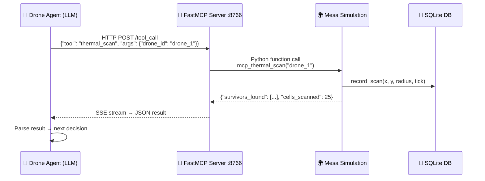

---

### 🛠️ All 26 Tools — By Category

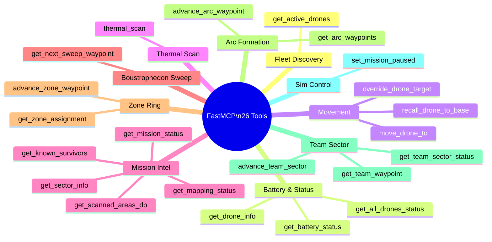

---

### 📊 Tools Reference Table

<div align="center">

#### 🔍 Fleet & Status

| Tool | Input | Output | Notes |
|------|-------|--------|-------|
| `get_active_drones` | — | `["drone_1"…]` | **Always call first.** IDs are runtime-assigned |
| `get_battery_status` | `drone_id` | `{battery, status, warning}` | Warning if ≤ 20% |
| `get_drone_info` | `drone_id` | `{x, y, battery, target, range…}` | Full snapshot |
| `get_all_drones_status` | — | list of drone dicts | Fleet-wide in one call |

#### 🚁 Movement

| Tool | Input | Output | Notes |
|------|-------|--------|-------|
| `move_drone_to` | `drone_id, x, y` | `"OK"` / `"REFUSED"` | Refused if battery ≤ 20% |
| `override_drone_target` | `drone_id, x, y` | confirmation | Supervisor force-redirect |
| `recall_drone_to_base` | `drone_id` | confirmation | Auto-recharge on arrival |

#### 🌡️ Scanning

| Tool | Input | Output | Notes |
|------|-------|--------|-------|
| `thermal_scan` | `drone_id` | `{survivors_found, cells}` | 100 m radius, 5×5 area |

#### 📈 Mission Intel

| Tool | Input | Output | Notes |
|------|-------|--------|-------|
| `get_mission_status` | — | `{tick, rescued, total, pct}` | Check `mission_complete` flag |
| `get_sector_info` | — | `{sector: {x,y}}` | 8 Manila districts |
| `get_mapping_status` | — | `{pct, unmapped[]}` | Phase 1 done at 100% |
| `get_scanned_areas_db` | — | summary string | Persistent DB — survives restarts |
| `get_known_survivors` | — | `[{id, x, y, critical}]` | Phase 2 rescue routing |

#### 🧭 Navigation Strategies

| Tool | Strategy | Input | Output |
|------|----------|-------|--------|
| `get_next_sweep_waypoint` | Boustrophedon | `drone_id` | `{x, y}` / `"complete"` |
| `get_zone_assignment` | Ring (OUTER→IN) | `drone_id` | `{zone, x, y}` |
| `advance_zone_waypoint` | Ring | `drone_id` | `{zone, ring_complete}` |
| `get_arc_waypoints` | Arc Formation | `drone_id` | `{waypoints[], index}` |
| `advance_arc_waypoint` | Arc Formation | `drone_id` | `{next_x, next_y, done}` |
| `get_team_waypoint` | Team Sector | `drone_id` | `{x, y, ring, remaining}` |
| `get_team_sector_status` | Team Sector | — | `{sector, pct, dispatched}` |
| `advance_team_sector` | Team Sector | — | `{status, new_sector}` |

#### ⚙️ Control

| Tool | Input | Output |
|------|-------|--------|
| `set_mission_paused` | `paused: bool` | `{status}` |

</div>

---

### 🔄 Three Navigation Strategies Compared

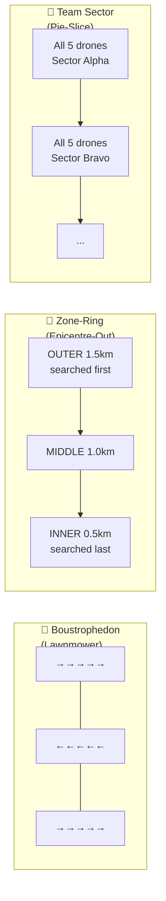

<div align="center">

| Strategy | Coverage Guarantee | Best For |
|----------|-------------------|---------|
| Boustrophedon | 100% (no cell missed) | Systematic full-area mapping |
| Zone-Ring | Highest-risk zones first | Time-critical triage |
| Team Sector | Coordinated depth-first | Dense urban environments |

</div>

---

## 4. AI Agentic Framework — LangGraph

> **File:** `src/agents/drone_agents.py`

### 🧠 Architecture — Decentralised Swarm

Every drone is an **independent ReAct agent** running in its own async task. There is no central brain — drones think locally and act locally.

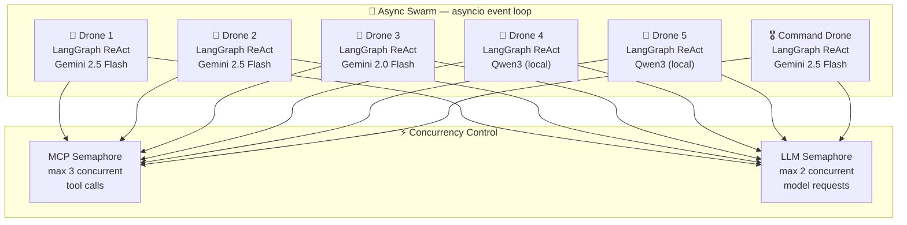

---

### 🤖 Supported Models

<div align="center">

| Model | Provider | Mode | Context | Temperature |
|-------|----------|------|---------|-------------|
| `gemini-2.5-flash` | Google AI | Cloud API | 1M tokens | 0 (deterministic) |
| `gemini-2.0-flash` | Google AI | Cloud API | 1M tokens | 0 |
| `gemini-3-flash-preview` | Google AI | Cloud API | — | 0 |
| `qwen3:4b-instruct` | Ollama (local) | Local inference | 4096 | 0 |
| `qwen3.5:9b` | Ollama (local) | Local inference | 4096 | 0 |
| `llama3` | Ollama (local) | Local inference | 4096 | 0 |
| `phi3` | Ollama (local) | Local inference | 4096 | 0 |

</div>

> Mix cloud and local: `python main.py --models gemini-2.5-flash,qwen3:4b-instruct`

---

### 🔬 X-Ray AI Pipeline — 6 Transparent Phases

Every drone decision goes through 6 logged phases, streamed live to the dashboard:

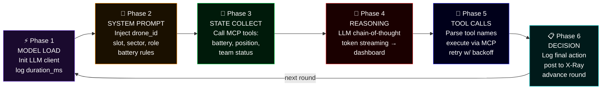

---

### 💬 Chain of Thought — ReAct Loop

LangGraph's `create_react_agent` implements the **Reasoning + Acting** loop. Here is what actually happens inside each drone's brain:

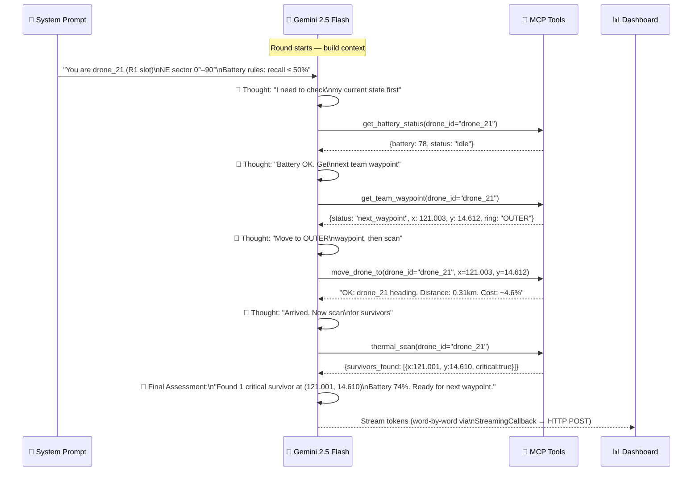

---

### 📡 Token Streaming Architecture

Every LLM token is streamed to the dashboard in real-time — no waiting for full responses.


---

### 🎭 Drone System Prompt (Actual Code)

The exact prompt injected into each drone agent:

```
OPERATION BAYANIHAN
═══════════════════════════════════════════════════════════
You are rescue drone {drone_id} — callsign {slot}
Scenario: Mw 7.4 earthquake, West Valley Fault, 06:47 PST
Sector: {region_name} ({angle_start}°–{angle_end}°)
Formation: 3-2 ring from Batasan Complex Emergency Hub

BATTERY RULES
  • Drains at 15% per km of flight
  • Start battery: 70–100%
  • Auto-recall triggers at 50% (OUTER drones)
  • After recharge to 80%: reassigned as INNER drone

ON-SITE TASK (at each waypoint)
  1. thermal_scan()     → find survivors
  2. Assess: count, critical?, cluster (3+ within 50m)?
  3. get_battery_status() → check reserve
  4. Report in SCAN RESULT format

OUTPUT FORMAT
  SCAN RESULT
    Position: (x, y) | Ring: OUTER/MIDDLE/INNER | Battery: XX%
    Survivors found: N (N critical)
    Cluster flag: YES / NO

  BATTERY STATUS
    Level: XX% | Warning: NONE / [text]

  ASSESSMENT
    [one-sentence field report]
═══════════════════════════════════════════════════════════
```

---

### 🛡️ Sector Boundary Enforcement

Each drone is hard-coded to its geographic pie-slice. The `make_tools()` wrapper **blocks cross-sector movement at the tool level** — before the MCP call is even made:

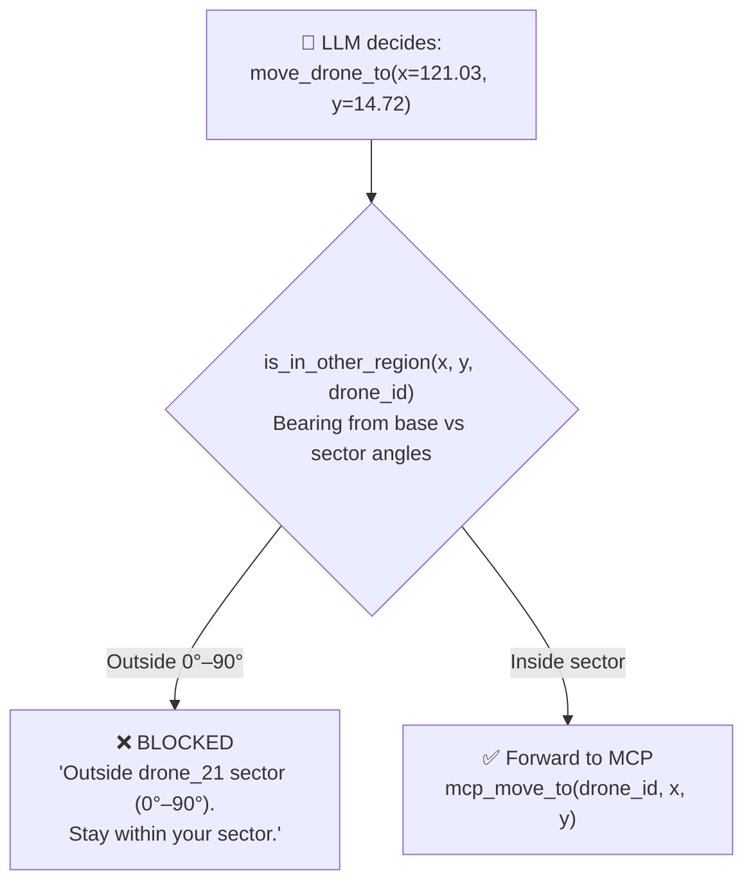

---

## 5. Persistence Layer — SQLite

> **File:** `src/core/db.py` · **Database:** `rescue_mission.db`

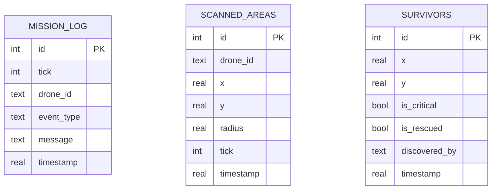

<div align="center">

| Table | Records When | Used By |
|-------|-------------|---------|
| `mission_log` | Any notable event | Dashboard log feed |
| `scanned_areas` | After every `thermal_scan` | `get_scanned_areas_db` tool — prevents re-scanning |
| `survivors` | Survivor detected | `get_known_survivors` tool — Phase 2 routing |

</div>

> The DB is **the single source of truth** across agent restarts. If the simulation crashes and restarts, drones query the DB and immediately know which areas have already been covered — solving LLM amnesia.

---

## 6. Live Dashboard — FastAPI

> **File:** `src/ui/dashboard.py` · **Port:** `8765`

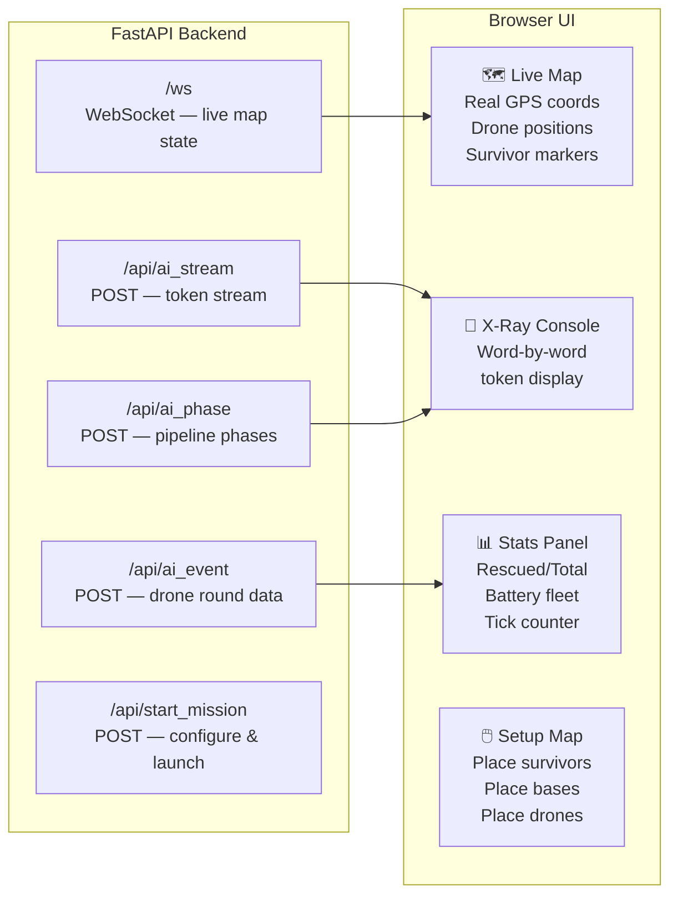

---

## 7. Full System Data Flow

```mermaid
sequenceDiagram
    participant U as 👤 Operator
    participant DASH as 📊 Dashboard :8765
    participant MAIN as 🚀 main.py
    participant MCP as 📡 MCP Server :8766
    participant SIM as 🌍 Mesa Simulation
    participant DB as 💾 SQLite
    participant AI as 🤖 LangGraph Agents

    U->>DASH: Place survivors, drones, bases
    U->>DASH: Click START MISSION
    DASH->>MAIN: POST /api/start_mission {survivors, drones, bases}
    MAIN->>SIM: configure_and_start()
    SIM->>SIM: _setup_event.set() → init model
    SIM->>SIM: _pause_event.set() → begin ticking

    par Simulation loop
        loop Every 0.35s
            SIM->>SIM: model.step() — all agents act
            SIM->>DASH: WebSocket → {drones, survivors, stats}
        end
    and AI Agent loop
        loop Every 6s per drone
            AI->>MCP: get_battery_status()
            MCP->>SIM: read drone state
            SIM-->>MCP: battery, status, position
            MCP-->>AI: JSON result
            AI->>AI: 💭 Reason (Gemini/Qwen3)
            AI->>DASH: Stream tokens (X-Ray)
            AI->>MCP: move_drone_to() / thermal_scan()
            MCP->>SIM: execute action
            SIM->>DB: record_scan() / log_event()
            SIM-->>MCP: result
            MCP-->>AI: confirmation
        end
    end
```

---

<div align="center">

## 🏗️ Technology Registry

| Component | Technology | Version | Purpose |
|-----------|-----------|---------|---------|
| Agent Simulation | **Mesa** | 3.0 | Agent-based model framework |
| Routing API | **OSRM** | Public | Street-realistic pathfinding |
| Pathfinding | **A\*** | Custom | GPS grid pathfinding fallback |
| Distance Math | **Haversine** | — | Accurate GPS distance on Earth |
| Agent Framework | **LangGraph** | Latest | ReAct agent loop |
| LLM (cloud) | **Gemini 2.5 Flash** | Latest | Primary reasoning engine |
| LLM (local) | **Qwen3 / Llama3** | 4b–9b | Offline / low-cost agents |
| Tool Protocol | **FastMCP** | 1.2.0 | LLM ↔ simulation interface |
| Transport | **SSE** | — | Server-Sent Events streaming |
| API Server | **FastAPI** | 0.115 | Dashboard + AI event endpoints |
| Token Streaming | **aiohttp** | 3.x | Real-time LLM output delivery |
| Concurrency | **asyncio** | stdlib | 5 parallel async agents |
| Persistence | **SQLite** | stdlib | Scan history + event log |
| Containerization | **Docker** | — | One-command cloud deploy |

<br>

[](https://mesa.readthedocs.io)
[](https://langchain-ai.github.io/langgraph/)
[](https://ai.google.dev)
[](http://project-osrm.org)
[](https://github.com/jlowin/fastmcp)

<br>

*"Non sibi sed aliis — Not for oneself, but for others"*

<br>

**Docs:** [ARCHITECTURE.md](ARCHITECTURE.md) · [MCP_TOOLS.md](MCP_TOOLS.md) · [SETUP.md](SETUP.md) · [GLOSSARY.md](GLOSSARY.md) · [TROUBLESHOOTING.md](TROUBLESHOOTING.md) · [CHANGELOG.md](CHANGELOG.md)

</div>


---

<div align="center">

# 📡 MCP Tools Reference
### Metro Manila Search & Rescue — FastMCP Server

[](https://github.com/jlowin/fastmcp)
[](https://developer.mozilla.org/en-US/docs/Web/API/Server-sent_events)
[](#)
[](#)

**Endpoint:** `http://localhost:8766/sse`

**Related docs:** [ARCHITECTURE.md](ARCHITECTURE.md) · [TECH_STACK.md](TECH_STACK.md) · [GLOSSARY.md](GLOSSARY.md)

</div>

---

## 🗂️ Tool Categories

| # | Category | Tools | Description |
|---|----------|:-----:|-------------|
| 1 | 🔍 Fleet Discovery | 1 | Find all active drone IDs |
| 2 | 🔋 Battery & Status | 3 | Check drone health and position |
| 3 | 🚁 Movement | 3 | Navigate drones across the map |
| 4 | 🌡️ Thermal Scanning | 1 | Detect survivors via infrared |
| 5 | 📊 Mission Intelligence | 5 | Progress, sectors, known survivors |
| 6 | 🧭 Sweep Navigation | 5 | Three pathfinding strategies |
| 7 | 👥 Team Sector Sweep | 3 | Coordinated 5-drone sector coverage |
| 8 | ⚙️ Simulation Control | 1 | Pause / resume the simulation |

---

## 1. 🔍 Fleet Discovery

> **Always call this first.** Drone IDs are assigned at runtime and must never be hardcoded.

| Tool | Args | Returns |
|------|------|---------|
| `get_active_drones` | — | `["drone_21", "drone_22", ...]` |

**Request:**
```json
{ "tool": "get_active_drones", "arguments": {} }
```
**Response:**
```json
["drone_21", "drone_22", "drone_23", "drone_24", "drone_25"]
```

---

## 2. 🔋 Battery & Status

> **Rule:** Never assign a mission if battery ≤ 20%. Always `recall_drone_to_base` first.

| Tool | Args | Returns | Notes |
|------|------|---------|-------|
| `get_battery_status` | `drone_id` | `{battery, status, warning}` | Warning fires at ≤ 20% |
| `get_drone_info` | `drone_id` | `{x, y, battery, status, home, target, rescued, range}` | Full single-drone snapshot |
| `get_all_drones_status` | — | list of drone dicts | Fleet-wide in one call |

**`get_battery_status` example:**
```json
// Request
{ "tool": "get_battery_status", "arguments": { "drone_id": "drone_21" } }

// Response
{ "drone_id": "drone_21", "battery": 78.5, "status": "idle", "warning": null }

// Response (low battery)
{ "drone_id": "drone_21", "battery": 18.2, "status": "low_batt", "warning": "Battery critical — recall immediately" }
```

**`get_drone_info` example:**
```json
// Request
{ "tool": "get_drone_info", "arguments": { "drone_id": "drone_22" } }

// Response
{
  "drone_id": "drone_22", "x": 120.993, "y": 14.601,
  "battery": 63.2, "status": "moving",
  "home_base": "Intramuros Base", "home_x": 120.975, "home_y": 14.589,
  "target_x": 121.001, "target_y": 14.610,
  "survivors_rescued": 2, "estimated_range_km": 0.87
}
```

**Drone statuses:**

| Status | Meaning |
|--------|---------|
| `idle` | At rest, ready for orders |
| `moving` | En route to target |
| `scanning` | Thermal scan in progress |
| `rescuing` | Extracting a survivor |
| `charging` | Docked at base station |
| `low_batt` | Auto-recall triggered |

---

## 3. 🚁 Movement

> **Battery cost:** `0.5% per km` flown (Haversine distance). Keep ≥ 20% reserve.

| Tool | Args | Returns | Notes |
|------|------|---------|-------|
| `move_drone_to` | `drone_id, x, y` | `"OK"` / `"REFUSED"` | Refused if battery ≤ 20% |
| `override_drone_target` | `drone_id, x, y` | confirmation string | Supervisor force-redirect — skips battery check |
| `recall_drone_to_base` | `drone_id` | confirmation string | Auto-recharges on arrival |

**`move_drone_to` example:**
```json
// Request
{ "tool": "move_drone_to", "arguments": { "drone_id": "drone_21", "x": 121.001, "y": 14.612 } }

// Response (success)
"OK: drone_21 heading to (121.0010, 14.6120). Distance: 0.31 km. Est. battery cost: ~0.2%."

// Response (refused)
"REFUSED: drone_21 battery 18% — recall to base first."
```

**Safe range formula:**
```
available_battery = current_battery - 20   (keep 20% reserve)
max_safe_km       = available_battery / 0.5
```

---

## 4. 🌡️ Thermal Scanning

| Tool | Args | Returns | Notes |
|------|------|---------|-------|
| `thermal_scan` | `drone_id` | `{survivors_found, scan_radius_km, tick}` | 100 m radius scan. Call at every waypoint. |

```json
// Request
{ "tool": "thermal_scan", "arguments": { "drone_id": "drone_21" } }

// Response — survivors found
{
  "drone_id": "drone_21",
  "position": { "x": 120.993, "y": 14.601 },
  "survivors_found": [
    { "id": "survivor_14", "x": 121.001, "y": 14.610, "critical": true,  "rescued": false },
    { "id": "survivor_27", "x": 120.990, "y": 14.598, "critical": false, "rescued": false }
  ],
  "scan_radius_km": 0.1,
  "tick": 142
}

// Response — no survivors
{
  "drone_id": "drone_21", "position": { "x": 120.993, "y": 14.601 },
  "survivors_found": [], "scan_radius_km": 0.1, "tick": 143
}
```

---

## 5. 📊 Mission Intelligence

| Tool | Args | Returns | Notes |
|------|------|---------|-------|
| `get_mission_status` | — | `{tick, rescued, total, pct, complete}` | Check `mission_complete` flag |
| `get_sector_info` | — | `{sector_name: {x, y}}` | **8** City of Manila districts |
| `get_mapping_status` | — | `{mapped_pct, unmapped_sectors[]}` | Phase 1 complete at 100% |
| `get_scanned_areas_db` | — | summary string | Persistent SQLite — survives restarts |
| `get_known_survivors` | — | `[{id, x, y, critical}]` | Unrescued survivors for Phase 2 routing |

**`get_mission_status` example:**
```json
// Request
{ "tool": "get_mission_status", "arguments": {} }

// Response
{
  "tick": 214, "survivors_rescued": 12, "survivors_total": 600,
  "rescue_pct": 2.0, "mission_complete": false,
  "total_distance_flown_km": 4.31, "total_battery_used_pct": 21.5,
  "recent_rescues": [
    { "tick": 209, "drone": "drone_22", "survivor": "survivor_14" }
  ]
}
```

**`get_team_sector_status` example:**
```json
// Request
{ "tool": "get_team_sector_status", "arguments": {} }

// Response
{
  "active_sector": "Alpha", "sector_index": 1, "total_sectors": 5,
  "color": "#FF6600", "angle_start": 0, "angle_end": 72,
  "waypoints_total": 50, "waypoints_dispatched": 23, "waypoints_remaining": 27,
  "drones_role_complete": ["drone_21"], "progress_pct": 46.0
}
```

**The 8 Search Sectors (City of Manila):**

| Sector | Longitude | Latitude |
|--------|-----------|----------|
| Intramuros | 120.975°E | 14.589°N |
| Ermita | 120.982°E | 14.578°N |
| Malate | 120.988°E | 14.570°N |
| Binondo | 120.974°E | 14.600°N |
| Tondo | 120.963°E | 14.616°N |
| Sampaloc | 120.994°E | 14.608°N |
| Santa Cruz | 120.982°E | 14.610°N |
| Paco | 120.993°E | 14.582°N |

---

## 6. 🧭 Sweep Navigation — 3 Strategies

### 🤖 Boustrophedon (Lawnmower)
Guaranteed 100% area coverage. Best for systematic full-map phase.

| Tool | Args | Returns |
|------|------|---------|
| `get_next_sweep_waypoint` | `drone_id` | `{x, y}` or `{status: "complete"}` |

---

### 🎯 Zone-Ring (Epicentre-Out)
Searches OUTER → MIDDLE → INNER. Prioritises collapse-risk perimeter first.

| Tool | Args | Returns | Notes |
|------|------|---------|-------|
| `get_zone_assignment` | `drone_id` | `{zone, x, y}` | Zone = `OUTER` / `MIDDLE` / `INNER` |
| `advance_zone_waypoint` | `drone_id` | `{zone, ring_complete}` | Auto-promotes ring when slice is done |

---

### 🌀 Arc Formation
Radial fan-sweep pattern for command-drone led formation flight.

| Tool | Args | Returns | Notes |
|------|------|---------|-------|
| `get_arc_waypoints` | `drone_id` | `{waypoints[], current_index}` | Full arc path list |
| `advance_arc_waypoint` | `drone_id` | `{next_x, next_y, complete}` | Advance to next arc position |

---

## 7. 👥 Team Sector Sweep

> All 5 drones converge on **one sector at a time**, then collectively advance.
> Role split: **R1 / R2 / R3 → OUTER ring** · **R4 / R5 → MIDDLE ring**

| Tool | Args | Returns | Notes |
|------|------|---------|-------|
| `get_team_waypoint` | `drone_id` | `{status, x, y, ring, remaining}` | Returns `role_complete` when drone's slice is done |
| `get_team_sector_status` | — | `{sector, index, total, pct, dispatched}` | Fleet-wide sector progress |
| `advance_team_sector` | — | `{status, new_sector}` | Returns `not_ready` until all 5 drones finish |

**5 Team Sectors:**

| Sector | Angle Range | Color |
|--------|------------|-------|
| Alpha (S1) | 0° – 72° | 🟠 Orange |
| Bravo (S2) | 72° – 144° | 🔴 Red |
| Charlie (S3) | 144° – 216° | 🔵 Blue |
| Delta (S4) | 216° – 288° | 🟢 Green |
| Echo (S5) | 288° – 360° | 🟣 Purple |

---

## 8. ⚙️ Simulation Control

| Tool | Args | Returns |
|------|------|---------|
| `set_mission_paused` | `paused: bool` | `{status: "paused"}` / `{status: "resumed"}` |

---

## 🔄 Mission Phase Flow

> **See also:** [ARCHITECTURE.md](ARCHITECTURE.md) for the full system diagram · [GLOSSARY.md](GLOSSARY.md) for term definitions · [TROUBLESHOOTING.md](TROUBLESHOOTING.md) if tools aren't responding

```mermaid
sequenceDiagram
    participant AI as 🤖 Agent
    participant MCP as 📡 Tools

    rect rgb(235, 245, 255)
        Note over AI,MCP: PHASE 1 — MAP
        AI->>MCP: get_active_drones()
        AI->>MCP: get_all_drones_status()
        loop Every Sector Tick
            AI->>MCP: get_team_waypoint()
            MCP-->>AI: {x, y, ring}
            AI->>MCP: move_drone_to()
            AI->>MCP: thermal_scan()
            AI->>MCP: advance_zone_waypoint()
        end
    end

    rect rgb(255, 235, 235)
        Note over AI,MCP: PHASE 2 — RESCUE
        AI->>MCP: get_known_survivors()
        MCP-->>AI: [critical targets]
        loop Every Survivor
            AI->>MCP: move_drone_to(target.x, target.y)
            AI->>MCP: thermal_scan()
        end
    end
```


---

