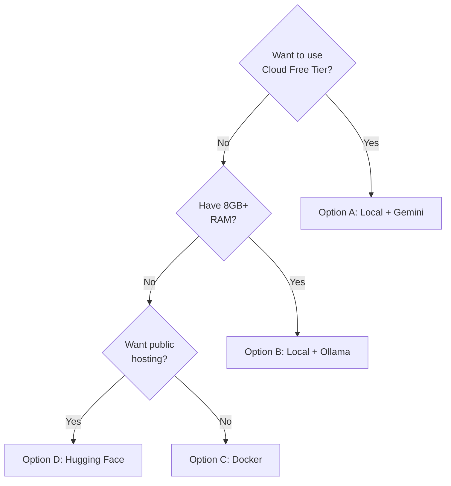
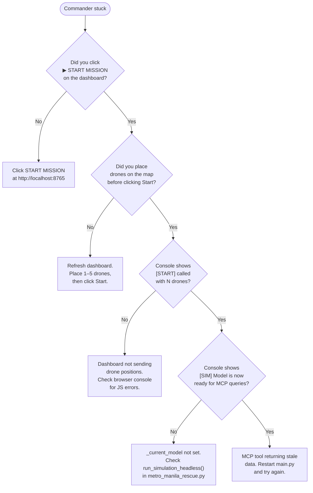
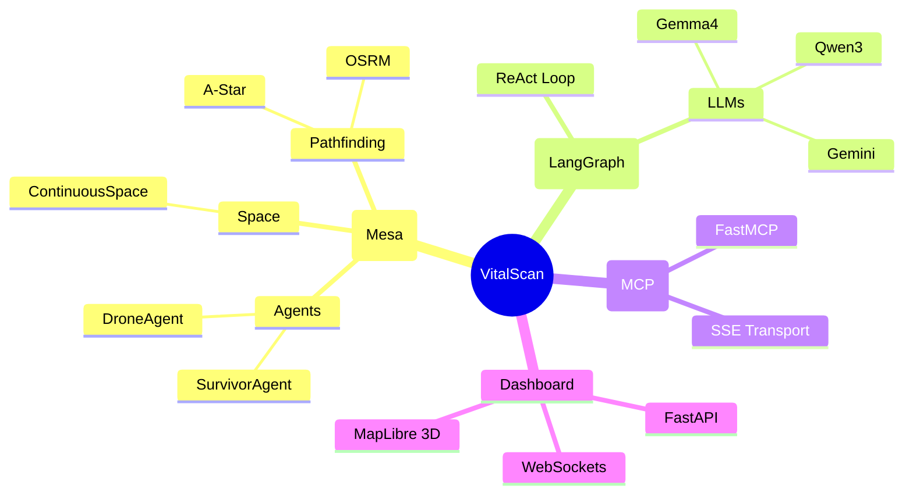

<!-- Compiled Documentation: USER_GUIDE.md -->

<div align="center">

# ⚙️ Setup Guide
### Metro Manila Search & Rescue Swarm

[](https://python.org)
[](https://docker.com)
[](https://huggingface.co/spaces)

</div>

---

## 🗺️ Choose Your Setup Path



---

## Prerequisites

- **Python 3.13+** — check with `python --version`
- **Git** — to clone the repo
- **4 GB RAM minimum** (8 GB recommended for local LLMs)

---

## Option A — Local + Gemini API

The fastest way to get running. Gemini 2.5 Flash has a free tier.

### 1. Clone & Install

```bash
git clone https://github.com/ngai123/VitalScan.git
cd VitalScan
pip install -r requirements.txt
```

### 2. Get a Gemini API Key

1. Go to [aistudio.google.com](https://aistudio.google.com)
2. Click **Get API key** → **Create API key**
3. Copy the key

### 3. Set the Key

```bash
# macOS / Linux
export GOOGLE_API_KEY='your-key-here'

# Windows (Command Prompt)
set GOOGLE_API_KEY=your-key-here

# Windows (PowerShell)
$env:GOOGLE_API_KEY='your-key-here'
```

### 4. Run

```bash
python main.py --models gemini-2.5-flash
```

### 5. Open the Dashboard

Navigate to **http://localhost:8765**, place entities on the map, and click **▶ START MISSION**.

---

## Option B — Local + Ollama (No API Key)

Run fully offline with a local LLM. Slower than Gemini but free and private.

### 1. Install Ollama

```bash
# macOS
brew install ollama

# Linux
curl -fsSL https://ollama.com/install.sh | sh

# Windows — download installer from https://ollama.com
```

### 2. Pull a Model

```bash
# Recommended (fast, 4 GB)
ollama pull qwen3:4b-instruct

# Larger, more capable (9 GB)
ollama pull qwen3.5:9b
```

### 3. Start Ollama

```bash
ollama serve
# Runs at http://localhost:11434
```

### 4. Clone & Install

```bash
git clone https://github.com/ngai123/VitalScan.git
cd VitalScan
pip install -r requirements.txt
```

### 5. Run

```bash
python main.py --models qwen3:4b-instruct
```

### Mix Cloud + Local

Run different models on different drones:

```bash
python main.py --models gemini-2.5-flash,qwen3:4b-instruct
```

Drones cycle through the model list — first drone uses model 1, second uses model 2, etc.

---

## Option C — Docker

### 1. Build the Image

```bash
git clone https://github.com/ngai123/VitalScan.git
cd VitalScan
docker build -t metro-manila-rescue .
```

### 2. Run

```bash
docker run -p 7860:7860 -p 8766:8766 \
  -e GOOGLE_API_KEY='your-key-here' \
  metro-manila-rescue
```

### 3. Open

Navigate to **http://localhost:7860**

> The Docker image uses port `7860` (Hugging Face Spaces standard). Locally this maps to the same port.

---

## Option D — Hugging Face Spaces (Free Cloud)

Deploy publicly with zero server costs.

### 1. Create a Space

1. Go to [huggingface.co/new-space](https://huggingface.co/new-space)
2. **Space SDK** → select `Docker`
3. **Visibility** → Public or Private

### 2. Push the Code

```bash
git clone https://github.com/ngai123/VitalScan.git
cd VitalScan

# Add HuggingFace remote
git remote add hf https://huggingface.co/spaces/YOUR_USERNAME/YOUR_SPACE_NAME

# Push
git push hf main
```

### 3. Add Your API Key as a Secret

1. Go to your Space → **Settings** → **Repository secrets**
2. Add: `GOOGLE_API_KEY` = `your-gemini-key`

HF Spaces automatically injects secrets as environment variables. The Dockerfile reads `GOOGLE_API_KEY` at runtime.

### 4. Wait for Build

The Space will build and deploy automatically (~2–3 minutes). Access it at:
`https://huggingface.co/spaces/YOUR_USERNAME/YOUR_SPACE_NAME`

---

## Environment Variables Reference

| Variable | Default | Description |
|----------|---------|-------------|
| `GOOGLE_API_KEY` | — | **Required** for Gemini models |
| `PORT` | `7860` | Dashboard HTTP port |
| `MCP_PORT` | `8766` | MCP SSE server port |
| `MCP_SERVER_URL` | `http://0.0.0.0:8766` | MCP server URL (internal) |
| `DASHBOARD_URL` | `http://0.0.0.0:7860` | Dashboard URL (internal) |
| `DASHBOARD_AI_URL` | `http://0.0.0.0:7860/api/ai_event` | AI event endpoint |
| `HEADLESS` | `false` | Set `true` to skip auto-opening browser |

---

## CLI Reference

```
python main.py [--models MODEL_LIST]

Arguments:
  --models    Comma-separated list of LLM model names.
              Each drone cycles through the list.
              Default: gemini-2.5-flash

Examples:
  python main.py --models gemini-2.5-flash
  python main.py --models qwen3:4b-instruct
  python main.py --models gemini-2.5-flash,qwen3:4b-instruct,gemini-2.0-flash
```

---

## Supported Models

| Model ID | Provider | Needs Key |
|----------|----------|-----------|
| `gemini-2.5-flash` | Google AI | `GOOGLE_API_KEY` |
| `gemini-2.0-flash` | Google AI | `GOOGLE_API_KEY` |
| `gemini-3-flash-preview` | Google AI | `GOOGLE_API_KEY` |
| `qwen3:4b-instruct` | Ollama (local) | None |
| `qwen3.5:9b` | Ollama (local) | None |
| `llama3` | Ollama (local) | None |
| `phi3` | Ollama (local) | None |

---

## Common Setup Errors

| Error | Cause | Fix |
|-------|-------|-----|
| `GOOGLE_API_KEY not set` | Env var missing | `export GOOGLE_API_KEY='...'` |
| `Port 8766 already in use` | Previous run still alive | `main.py` auto-kills it; or run `lsof -ti:8766 \| xargs kill` |
| `Port 8765 already in use` | Same as above | `lsof -ti:8765 \| xargs kill` |
| `Ollama service not detected` | Ollama not running | Run `ollama serve` in a separate terminal |
| `model 'qwen3' not found` | Model not pulled | `ollama pull qwen3:4b-instruct` |
| `MCP server did not start in time` | Slow machine | Increase `SERVER_READY_TIMEOUT` in `main.py` |
| Dashboard blank on load | Simulation not started yet | Place entities on map and click **▶ START MISSION** |

---

> **Next:** [ARCHITECTURE.md](ARCHITECTURE.md) — understand how the system works


---

<div align="center">

# 🔧 Troubleshooting Guide
### Metro Manila Search & Rescue Swarm

[](#bug-fixes)
[](#common-issues)

</div>

---

## Quick Diagnostics

| Symptom | Jump to |
|---------|---------|
| Commander says "all drones busy — waiting" forever | [Issue #1](#issue-1--commander-stuck-waiting-for-drones) |
| Dashboard map is blank after START MISSION | [Issue #2](#issue-2--dashboard-blank-after-start-mission) |
| Port already in use error | [Issue #3](#issue-3--port-already-in-use) |
| Ollama model not found | [Issue #4](#issue-4--ollama-model-not-found) |
| Drones not moving after mission start | [Issue #5](#issue-5--drones-not-moving) |
| `GOOGLE_API_KEY not set` error | [Issue #6](#issue-6--google_api_key-not-set) |
| MCP server timeout | [Issue #7](#issue-7--mcp-server-did-not-start-in-time) |

---

## Common Issues

### Issue #1 — Commander Stuck Waiting for Drones

**Symptom:**
```
[COMMANDER] Waiting for simulation to initialize with drones...
[COMMANDER] Waiting for simulation to initialize with drones...
  (repeats indefinitely)
```

**Root Cause Flowchart:**



**Expected healthy startup sequence:**
```
[START] configure_and_start() called with 8 survivors, 3 drones, 1 bases
[SIM]   → Placing 3 custom drone(s)...
[SIM]   ✓ Drone 1: spawn=(120.981, 14.591) status=idle
[SIM]   ✓ Drone 2: spawn=(120.979, 14.589) status=idle
[SIM]   ✓ Drone 3: spawn=(120.982, 14.588) status=idle
[SIM] Metro Manila Rescue started — Survivors: 8, Drones: 3
[SIM] Model is now ready for MCP queries!
[COMMANDER] Ready! 3 drones detected.
```

---

### Issue #2 — Dashboard Blank After START MISSION

**Symptom:** Map renders but no drones or survivors appear after clicking Start.

**Checks:**
1. Open browser DevTools → Console tab — look for WebSocket errors
2. Confirm the simulation is ticking: console should show periodic `[SIM]` output
3. Confirm the MCP server started: look for `[MCP] MCP server → http://localhost:8766`

**Fix:** The WebSocket connection may have failed to establish before the page loaded. Hard-refresh the dashboard (`Cmd+Shift+R` / `Ctrl+Shift+R`) and click Start again.

---

### Issue #3 — Port Already in Use

**Symptom:**
```
OSError: [Errno 48] Address already in use: ('0.0.0.0', 8766)
```

`main.py` auto-kills processes on ports 8765 and 8766 at startup using `lsof`. If it fails (e.g. on Windows), kill manually:

```bash
# macOS / Linux
lsof -ti:8766 | xargs kill -9
lsof -ti:8765 | xargs kill -9

# Windows (PowerShell)
netstat -ano | findstr :8766
taskkill /PID <PID> /F
```

---

### Issue #4 — Ollama Model Not Found

**Symptom:**
```
❌ [AI] Ollama is running, but model 'qwen3:4b-instruct' was not found.
   → Run: ollama pull qwen3:4b-instruct
```

**Fix:**
```bash
ollama pull qwen3:4b-instruct
# Then restart main.py
```

If Ollama itself is not running:
```bash
# Start Ollama service
ollama serve

# Verify it's up
curl http://localhost:11434/api/tags
```

---

### Issue #5 — Drones Not Moving

**Symptom:** Dashboard shows drones at base, status stays `idle` indefinitely after mission start.

**Checks:**

| Log to look for | Meaning |
|----------------|---------|
| `[drone_21] Executed move_drone_to: OK` | Drone received move command ✅ |
| `[drone_21] Executed move_drone_to: REFUSED` | Battery ≤ 20% — recall first |
| `[drone_21] BLOCKED: outside sector` | Waypoint outside assigned pie-slice |
| No `[drone_21]` output at all | LLM not responding — check API key or Ollama |

**Common fix:** The LLM is not calling any tools. Check that:
- `GOOGLE_API_KEY` is set (for Gemini)
- `ollama serve` is running (for local models)
- The model name in `--models` exactly matches a supported model ID (see [SETUP.md](SETUP.md#supported-models))

---

### Issue #6 — `GOOGLE_API_KEY not set`

**Symptom:**
```
EnvironmentError: GOOGLE_API_KEY not set.
```

**Fix:**
```bash
export GOOGLE_API_KEY='your-key-here'
python main.py --models gemini-2.5-flash
```

Get a free key at [aistudio.google.com](https://aistudio.google.com). Alternatively, switch to a local model — no key needed:
```bash
python main.py --models qwen3:4b-instruct
```

---

### Issue #7 — MCP Server Did Not Start in Time

**Symptom:**
```
[SYSTEM] MCP server did not start in time. Check mcp_server.py.
```

**Cause:** `mcp_server.py` took longer than 30 seconds to be ready (slow machine, dependencies loading slowly).

**Fix:** Increase the timeout in `main.py`:
```python
SERVER_READY_TIMEOUT = 60  # was 30
```

---

## Log Prefix Reference

| Prefix | File | What it means |
|--------|------|---------------|
| `[START]` | `metro_manila_rescue.py` | `configure_and_start()` was called with placement data |
| `[SIM]` | `metro_manila_rescue.py` | Model init, drone/survivor placement, tick events |
| `[MCP]` | `mcp_server.py` | Tool call received or returned |
| `[SYSTEM]` | `main.py` | Top-level orchestration events |
| `[COMMANDER]` | `command_agent.py` | Command drone AI decisions |
| `[drone_XX]` | `drone_agents.py` | Individual rescue drone AI output |
| `[DB]` | `db.py` | SQLite read/write operations |
| `[VIZ]` | `mcp_server.py` | Dashboard URL announcement |
| `[OSRM ERROR]` | `metro_manila_rescue.py` | OSRM routing API failed — A\* fallback activated |

---

## Known Bug Fixes (Historical)

These bugs were fixed in v1.2.0. Documented here for reference.

### Bug #1 — Duplicate Variable Declaration ✅

**File:** `metro_manila_rescue.py`

`_custom_survivors` was declared twice — second declaration silently overwrote the typed annotation from the first.

```python
# Fixed: consolidated to single typed declaration
_custom_survivors: list | None = None
_custom_drones: list | None = None
```

---

### Bug #2 — Commander Starts Before Drones Placed ✅ CRITICAL

**File:** `command_agent.py`

Commander AI launched immediately after MCP server started — before the user had placed any drones. Fixed by adding a polling loop that waits for a non-empty drone fleet before beginning mission logic.

```python
# Fixed: poll until fleet is ready
while not drone_list:
    await asyncio.sleep(2)
    drones = await _call(session, "get_active_drones")
    drone_list = json.loads(drones) if drones else []
```

---

### Bug #3 — Model Global Not Re-Assigned ✅

**File:** `metro_manila_rescue.py`

`_current_model` was set inside `MetroManilaRescueModel.__init__()` but `run_simulation_headless()` created a new instance without re-assigning the global. MCP tools reading `_current_model` would get stale or `None` data.

```python
# Fixed: explicit global re-assignment in run_simulation_headless()
global _current_model
model = MetroManilaRescueModel()
_current_model = model
```

---

### Bug #4 — Silent Empty Fleet ✅

**File:** `metro_manila_rescue.py`

`get_active_drones()` returned `[]` with no console warning when the fleet was empty, making it impossible to know whether the issue was placement, initialisation, or query timing.

```python
# Fixed: added warning log
if not drones:
    print("[MCP] WARNING: get_active_drones() returned 0 drones.",
          file=sys.stderr, flush=True)
```

---

> **See also:** [SETUP.md](SETUP.md) for environment setup · [GLOSSARY.md](GLOSSARY.md) for term definitions


---

<div align="center">

# 📖 Glossary
### Metro Manila Search & Rescue Swarm

</div>

---

## 🧠 Concept Map



---

## 📚 Terminology

| Term | Definition |
|------|------------|
| **A\*** | Grid-based pathfinding algorithm used as a fallback for OSRM. |
| **Arc Formation** | Radial 3-2-1 navigation strategy expanding outward from the base. |
| **Base Station** | Fixed charging hubs (e.g. Roxas Blvd, Intramuros). |
| **Battery Drain** | Constant 0.5% per km flight cost calculated via Haversine. |
| **Boustrophedon** | Back-and-forth lawnmower sweep pattern guaranteeing 100% coverage. |
| **Callsign** | Specific role designated to a drone (R1, R2, CMD). |
| **ContinuousSpace** | Mesa environment where agents use real floating-point GPS coords. |
| **FastAPI** | Python web framework powering the port 8765 dashboard. |
| **FastMCP** | Python library defining the SSE tools (port 8766) over the MCP protocol. |
| **GeoJSON** | JSON format for geographical mappings (e.g., OSRM path responses). |
| **Haversine** | Spherical formula used to calculate true Earth distances between GPS points. |
| **LangGraph / LLM** | Agentic framework managing ReAct loops powered by Large Language Models. |
| **MCP** | Model Context Protocol — standardized API format for LLM tool calling. |
| **Mesa** | Python framework running the core agent-based simulation loop. |
| **Ollama** | Local LLM server running models like Qwen3 and Gemma4. |
| **OSRM** | Public routing API providing highly realistic street geometry for drones. |
| **ReAct** | Reasoning + Acting: The cycle LLMs use to think and fire tools. |
| **Ring Swap** | Protocol where a MIDDLE drone dynamically replaces a depleted OUTER drone. |
| **Semaphore** | Asyncio lock preventing API connection exhaustion (e.g., max 3 tool calls). |
| **SSE** | Server-Sent Events streams; handles asynchronous tool communication. |
| **Team Sector Sweep** | Converged 5-drone search targeting a single 72° pie-slice sector. |
| **Thermal Scan** | Simulated 100m infrared scan detecting survivors. |
| **X-Ray Console / TCC** | The Tactical Command Center streaming LLM chain-of-thought in real-time. |

> **See also:** [TECH_STACK.md](TECH_STACK.md) · [ARCHITECTURE.md](ARCHITECTURE.md)


---

