<!-- Compiled Documentation: AI_AGENT_MANUAL_ZH.md -->

# 🤖 AI 系统提示词 — 逻辑与哲学

本文档概述了 VitalScan 无人机集群所使用的“感知-思考-行动”(Sense-Think-Act) 循环，并详细说明了提供给 AI 模型的具体逻辑。

---

## 🔄 “感知-思考-行动” 循环

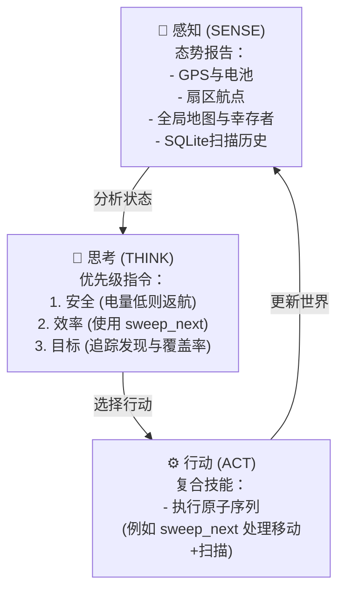

---

## 🎯 核心系统与指令

| 系统 | 角色 / 身份 | 主要工作流 | 核心指令与焦点 |
|--------|-----------------|------------------|-------------------------|
| 🚁 **救援无人机 (Drone Agent)**  (*DRONE_ONSITE_SYSTEM*) | 一线响应者 | 循环执行 `sweep_next()` 直至扇区 100% 测绘完成。 | 格式：位置 `\|` 电量 `\|` 幸存者。 |
| 🎖️ **指挥无人机 (Command Drone)**  (*COMMANDER_SYSTEM*) | 编队主管 | 路线 `safe_navigate()`，通过 `fleet_overview()` 监控。 | 检测层级替换 (Ring Swaps)；报告机队就绪状态。 |
| 📐 **扇形展开 (Fan Spread)**  (*FAN_SPREAD_SYSTEM*) | 走廊协调 | 为每架无人机分配 2.0km → 0km 深度切片。 | 集中于 1.0km 灾难焦点进行扫描；确保无盲区。 |

---

## 📋 修改提示词的最佳实践
1. **言简意赅**：AI 模型（尤其是像 Qwen 这样的小模型）在直接、非对话式的指令下表现更好。
2. **使用 Markdown**：使用 `#` 和 `##` 标题构建提示词，能提升模型的意图识别能力。
3. **技能优先级**：始终优先提及“复合技能”（8个高级工具），因为它们比原始的原子工具更安全、更稳健。

---

# 🛠️ AI 智能体技能
### 马尼拉大都会搜索与救援无人机集群

---

## 🧠 技能分类导图

无人机利用技能层级进行操作。**原子技能 (Atomic Skills)** 是对物理引擎的直接命令，而**复合技能 (Composite Skills)** 则将多个操作捆绑为高级工作流。

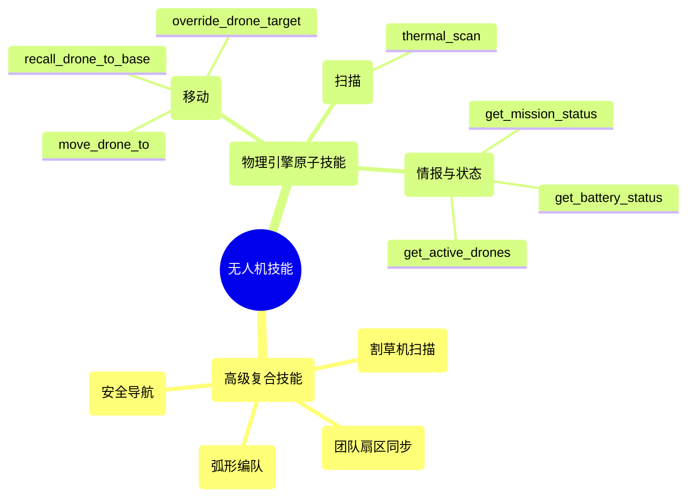

---

## ⚡ 复合技能 vs 原子技能

AI 应优先使用 **复合技能**，而不是手动链接原子命令。复合技能通过在后端组合逻辑来减少 token 使用并防止幻觉。

### 复合技能可视化展示：`sweep_next()`

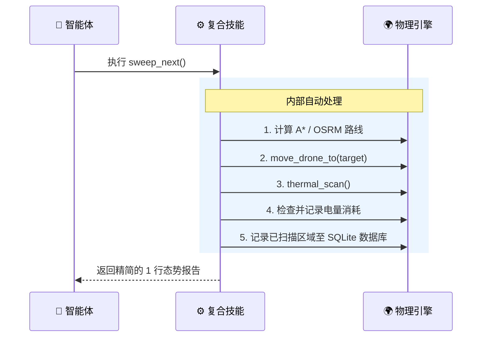

---

## 🧰 战术技能矩阵

| 类别 | 技能 / 工具 | 功能 | 风险 / 消耗 |
|:---|:---|:---|:---|
| 🚁 **飞行** | `move_drone_to(x,y)` | 移动无人机到特定 GPS 坐标。 | 🟡 `0.5% 电量 / km` |
| 🚁 **飞行** | `recall_drone_to_base()` | 紧急返航进行维修或充电。 | 🟢 在基地自动充电 |
| 🌡️ **传感器** | `thermal_scan()` | 探测半径 100m 内的幸存者。 | 🟢 无消耗 |
| 📊 **情报** | `get_mapping_status()` | 获取全局地图完成百分比。 | 🟢 无消耗 |
| 📊 **情报** | `get_known_survivors()` | 从 SQLite 中拉取危重目标列表。 | 🟢 无消耗 |
| 👥 **团队** | `advance_team_sector()` | 推进整个 5 架无人机编队进入下一个扇区。 | 🔴 如果团队未就绪则阻塞 |

---

## 🚨 紧急覆盖 (系统技能)

以下技能绕过 AI，完全由后端环境处理。AI 无法阻止它们的发生。

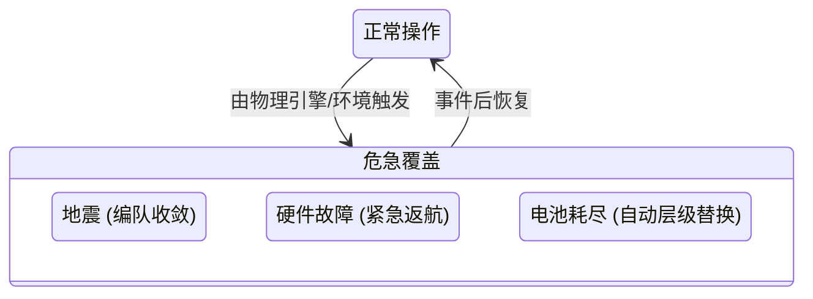

---

## 🔗 技能到 MCP 工具映射流程图

每个高级 **复合技能** 都充当自动排序多个低级 **MCP 工具** 的包装器。以下是智能体技能如何直接映射到开放的 26 个 MCP 工具。

### 1. Boustrophedon Sweep (救援无人机主要技能)
此技能使“割草机”搜索模式自动化。AI 无需计算几何图形，只需循环使用此技能来处理扇区。

**调用的 MCP 工具:** `get_team_waypoint` ➔ `move_drone_to` ➔ `thermal_scan` ➔ `advance_zone_waypoint`

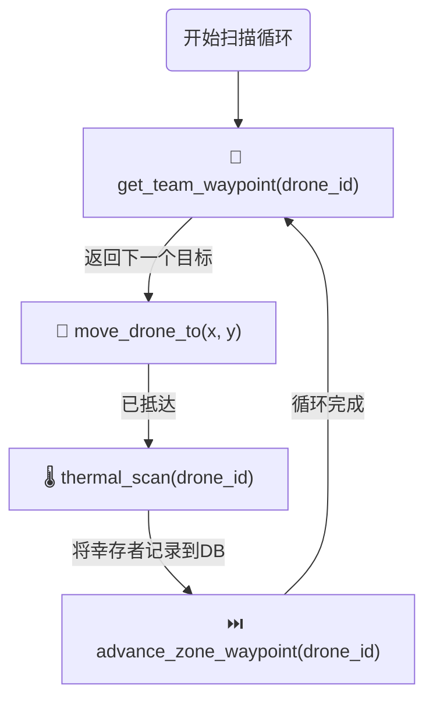

### 2. Team Sector Sync (集群协调技能)
确保没有任何单架无人机会在 5 架无人机编队的其余部分完成各自的切片之前放弃其扇区。

**调用的 MCP 工具:** `get_team_sector_status` ➔ `get_active_drones` ➔ `advance_team_sector`

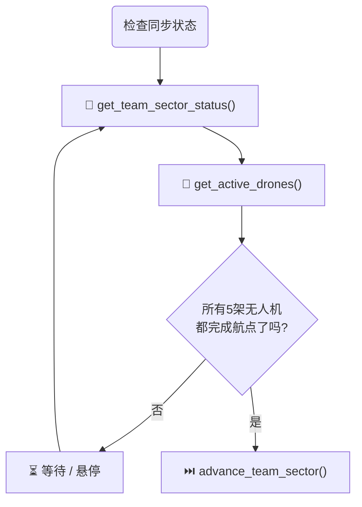

### 3. Arc Formation (指挥无人机导航)
指挥 (CMD) 无人机使用此技能使其观测弧线扫过灾区，而不主动搜索幸存者。

**调用的 MCP 工具:** `get_arc_waypoints` ➔ `move_drone_to` ➔ `advance_arc_waypoint` ➔ `get_all_drones_status`

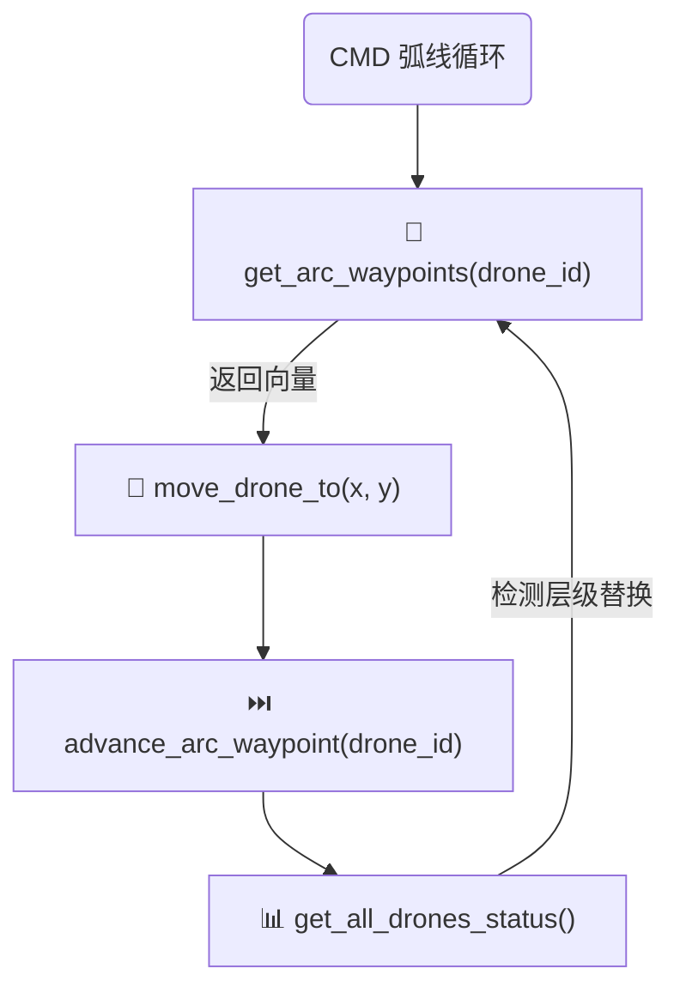

---

# 🎖️ 无人机集群层级
### 指挥机与救援机关系

---

## 🧠 机队指挥链

VitalScan 集群利用 1 对 5 的去中心化指挥结构。虽然所有智能体都是自主的，但它们的目标和权限在很大程度上取决于它们分配的环形层级和角色。

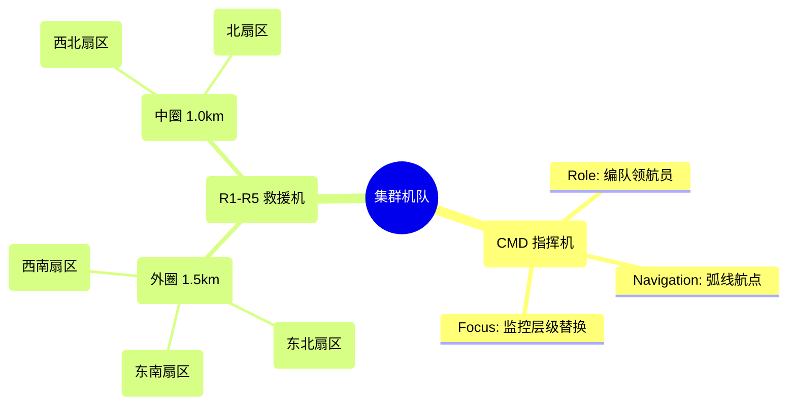

---

## 📡 观测与通信流

CMD 无人机**不**直接指挥救援无人机。相反，它通过 `FastMCP` 服务器观测它们的状态。物理引擎自动处理晋升（层级替换 Ring Swaps），而 CMD 无人机会向仪表盘报告整体状态。

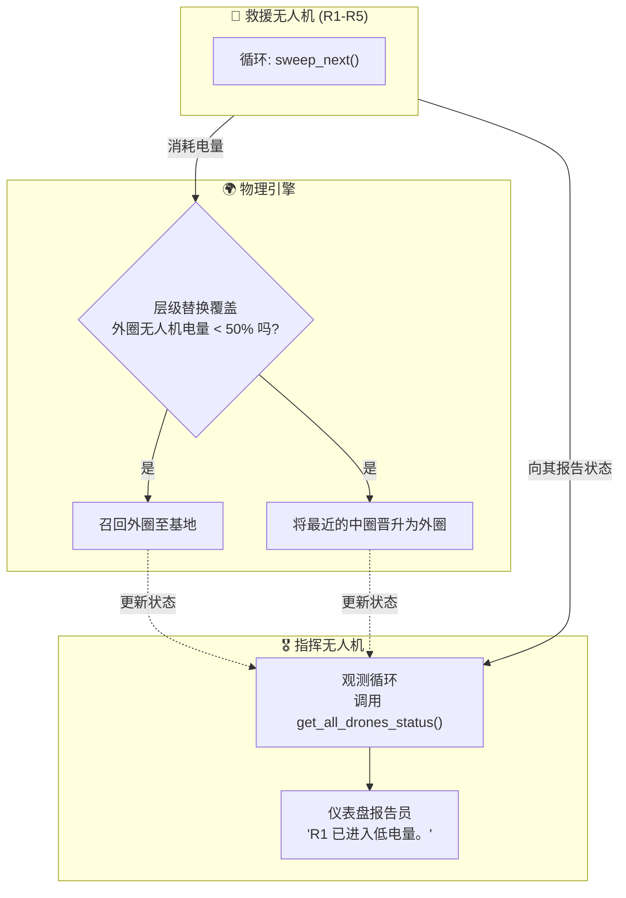

---

## ⚖️ 角色对比

| 特征 | 🎖️ 指挥无人机 (CMD) | 🚁 救援无人机 (R1-R5) |
| :--- | :--- | :--- |
| **主要任务** | 监督机队就绪情况并维持弧形编队。 | 扫描幸存者并测绘扇区。 |
| **搜索责任** | **无。** 不调用 `thermal_scan()`。 | **完全。** 在每个航点执行扫描。 |
| **导航模式** | 径向弧线编队 (`get_arc_waypoints`)。 | 扇区扫描 (`get_team_waypoint`)。 |
| **电池阈值** | `≤ 50%` 返航 (自我召回)。 | `≤ 50%` 返航 (由物理引擎自动召回)。 |
| **应对地震**| 暂停进行地震带测量。 | 暂停进行地震带测量并收敛。 |

---

# 🧠 AI 工程技术
### 提示词、上下文和约束策略

本文档详细介绍了用于将标准文本生成模型转变为高度自主、可靠救援智能体的高级 LLM 工程技术。

---

## 1. 📝 提示词工程 (Prompt Engineering)

VitalScan 中的提示词工程重点在于约束 LLM 的幻觉并强制输出确定性、可执行的行动。

### 🎯 角色扮演与身份注入
赋予无人机严格的操作身份。我们不仅要求模型“路由无人机”；我们还定义了其在集群中的确切状态。
> *"你是救援无人机 21 — 呼号 R1。你在 Alpha 扇区 (0°–90°) 运行。"*

### 🔄 ReAct (推理 + 行动)
我们利用 LangGraph `create_react_agent` 强制执行严格的思维链循环。该模型在进行`工具调用 (Tool Call)`之前必须先输出`想法 (Thought)`。

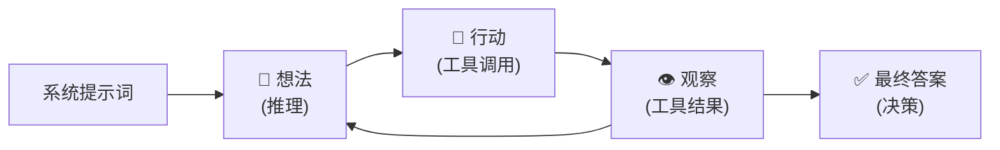

### 🧱 Markdown 结构化指令
为帮助小模型 (如 `qwen3:4b`) 解析指令，系统提示大量使用了 Markdown 标题 (`#`, `##`, `•`)，而不是对话式段落。

| 技术 | 示例 | 优势 |
| :--- | :--- | :--- |
| **反向约束** | `"如果电量 ≤ 20%，切勿继续"` | 防止不安全的工具执行。 |
| **数据格式化** | `"以 位置 \| 电量 \| 幸存者 格式报告"` | 强制生成易于扫描的结构化终端输出。 |
| **复合优先级** | `"使用 sweep_next() 而不是手动移动"` | 通过捆绑逻辑减少 token 消耗。 |

---

## 2. 🗄️ 上下文工程 (Context Engineering)

上下文工程确保 LLM 拥有做出决策所需的确切数据——而不会使上下文窗口溢出。

### 💾 持久化外部记忆 (SQLite)
LLM 在长期任务中会遭遇上下文遗忘。我们不将整个飞行历史放入上下文窗口，而是将扫描保存到 `rescue_mission.db`。
- **工作原理**: LLM 查询 `get_scanned_areas_db()` 来提取汇总的聚合地图数据，保持活跃的上下文窗口既小又新。

### 📍 动态情境注入
在每次决策之前，都会向 LLM 注入最新的遥测数据。它不需要“记住”自己在哪；系统会动态告知。

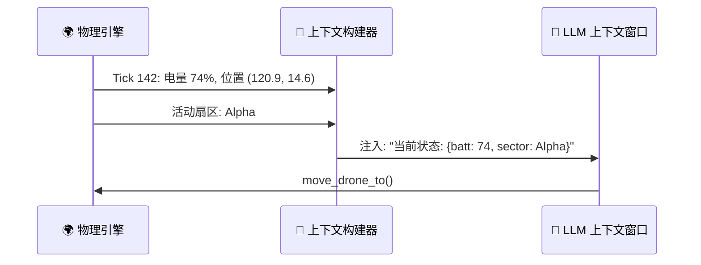

### 🛡️ 语义边界
我们通过拒绝提供不属于无人机的上下文来防止幻觉。位于 Alpha 扇区的无人机无法“看到” Delta 扇区的航点，从数学上降低了跨扇区干扰的可能性。

---

## 3. ⚙️ 约束工程 (Harnessing Engineering)

约束是指我们在非确定性的 LLM 与确定性的 Python 物理引擎 (Mesa) 之间建立的物理桥梁。

### 🔌 模型上下文协议 (MCP)
我们不依赖脆弱的字符串解析，而是使用 `FastMCP` 来约束模型。LLM 严格通过经 JSON-schema 验证的 Server-Sent Events (SSE) 与物理引擎交互。
- 如果 LLM 幻觉出一个无效的坐标，MCP 工具模式会在其破坏模拟之前拒绝它。

### 🚦 工具拦截与优雅失败
我们从不盲目信任 LLM 的工具调用。工具带有 Python 逻辑约束，可将自然语言错误返回给模型，允许其自我纠正。

| LLM 幻觉 | 约束拦截 | 发送给 LLM 的结果 |
| :--- | :--- | :--- |
| 尝试在仅 10% 电量时飞 5km | 物理层计算 Haversine 消耗。 | `"拒绝：电池严重不足。执行 recall_to_base()"` |
| 尝试扫描其扇区外部 | 包装器检查扇区边界。 | `"错误：目标在 Alpha 扇区边界之外。"` |
| 试图虚构一个工具 `scan_all()` | MCP schema 验证器捕获它。 | `"错误：未找到工具。可用工具：thermal_scan..."` |

### 🔬 遥测流 (X光指挥台)
为了让人类操作员掌握 AI 的推理过程，我们拦截了 LangGraph 链的 `StreamingCallback`。Token 逐字通过 WebSockets 推送给 **战术指挥中心 (Tactical Command Center)**，允许操作员实时监控 AI 内部的想法。
