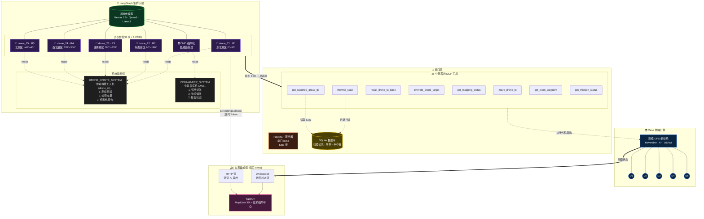
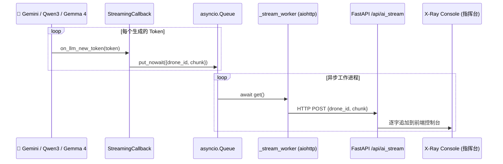
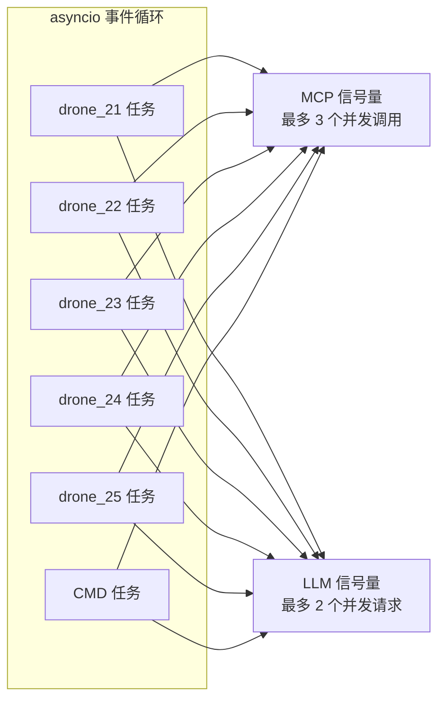
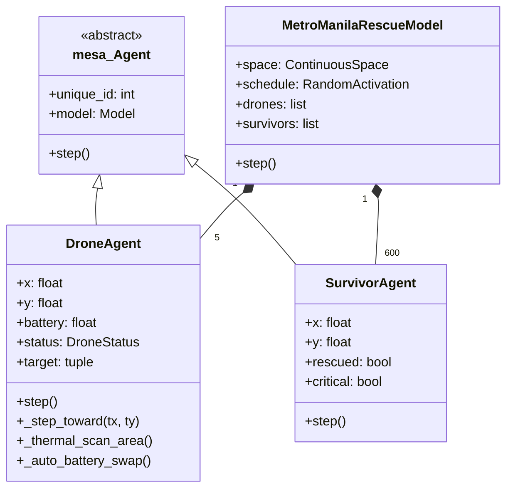
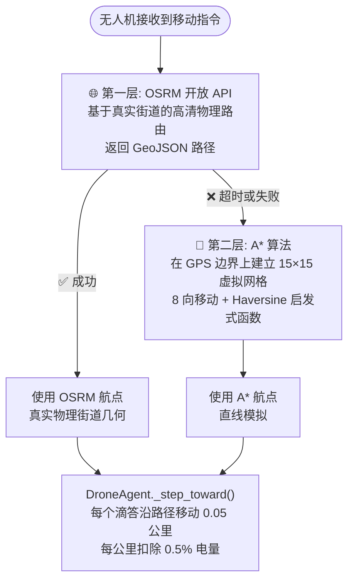
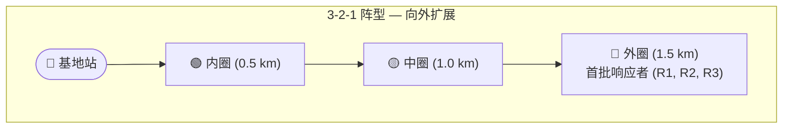
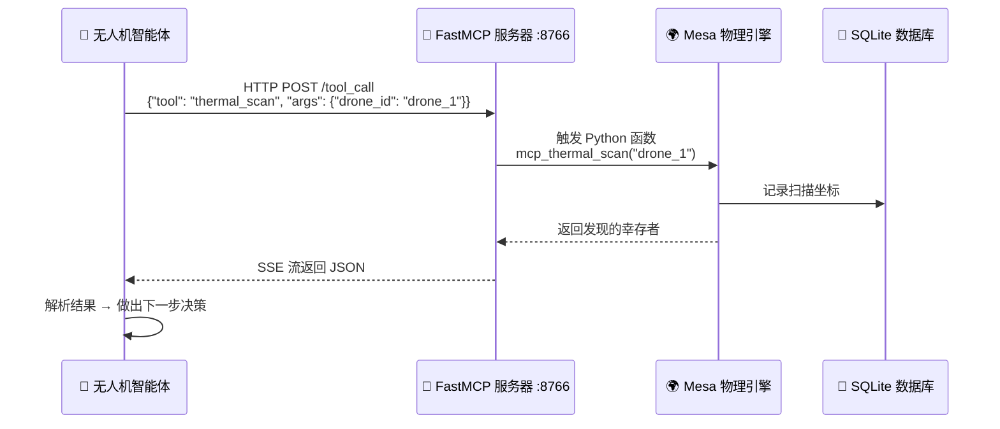
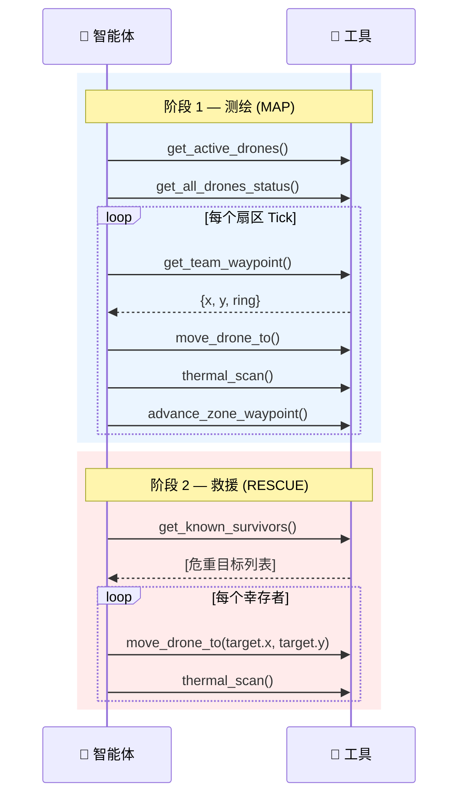

<!-- Compiled Documentation: SYSTEM_ARCHITECTURE_ZH.md -->

<div align="center">

# 🏗️ 系统架构与设计
### 马尼拉大都会搜索与救援无人机集群

[](https://langchain-ai.github.io/langgraph/)
[](https://mesa.readthedocs.io)
[](https://github.com/jlowin/fastmcp)
[](https://fastapi.tiangolo.com)

</div>

---

## 全局系统架构



---

## 智能体提示词逻辑

### 🚁 救援无人机 — `DRONE_ONSITE_SYSTEM`

每架救援无人机在每个航点执行战术报告提示词：

```
1. SCAN       执行 thermal_scan(drone_id)
              → 统计幸存者、标记危急、检测聚集区 (50m 内 3 人以上)

2. ASSESS     评估: 发现了多少人？有危急人员吗？

3. BATTERY    执行 get_battery_status(drone_id)
              → 若存在警报: 汇报警报，切勿前往下一航点

4. REPORT     以严格的结构化格式输出报告
```

**层级替换机制 (Battery Swap):** 如果外圈无人机电量降至 `≤ 50%`，物理引擎将强制自动召回它，并提升最近的中圈无人机到外圈。无人机**不会**手动调用召回命令——全由物理引擎接管。

**地震与故障强制覆盖:** 物理引擎独立于 AI 处理动态事件。如果进入地震带，所有无人机将冻结进行地质测量，随后收敛聚集，然后再返回各自的扫描路线。硬件故障发生在第 10 次扫描时，强制触发 A* 返航。

---

### 🎖️ 指挥无人机 — `COMMANDER_SYSTEM`

指挥 (CMD) 无人机**不执行扫描任务**。它按弧线巡航并监控整个编队：

```
每一个循环:
  步骤 1 → get_arc_waypoints(drone_id)       — 获取下一个弧线位置
  步骤 2 → move_drone_to(drone_id, x, y)     — 飞向该位置
  步骤 3 → advance_arc_waypoint(drone_id)    — 推进弧线光标
  步骤 4 → get_all_drones_status()           — 监控机队替换情况
  步骤 5 → get_battery_status(drone_id)      — 若 ≤ 50%: 自动召回自身
```

---

## 直播流架构 (Live Streaming)

本系统的标志性功能是 **大模型思维链实时流传输** — 无需等待完整响应生成。



---

## 并发模型 (Concurrency)



> **信号量 (Semaphores)** 可防止 Ollama 本地服务器与 MCP SSE 端点的连接耗尽崩溃。


---

<div align="center">

# 🛰️ 技术栈深度解析 (Tech Stack Deep Dive)
### 马尼拉大都会搜索与救援无人机集群

</div>

---

## 1. 模拟引擎 — Mesa 3.0

### 🗺️ 这是什么？

Mesa 是一个 Python **基于智能体的建模 (Agent-based modeling)** 框架。相较于全局方程式，每个实体（无人机、幸存者）都是一个带有状态和 `step()` 函数的 *独立智能体*。在每个模拟滴答 (tick) 中，每个智能体都会独立采取行动。



---

### 📐 地理空间 (Geographic Space)

模拟运行在 **真实的 GPS 坐标** 中——而非简化的网格。每个位置都是马尼拉大都会上空真实的经纬度。

```
地理边界 (马尼拉市)
─────────────────────────────────────────────────────
  西南角 →  14.550°N, 120.950°E
  东北角 →  14.630°N, 121.010°E
  宽度   →  ≈ 6.0 km  (东西跨度)
  高度   →  ≈ 8.9 km  (南北跨度)
  面积   →  ≈ 53.4 km²
─────────────────────────────────────────────────────
```

---

### 🧭 寻路算法 — 双层策略

无人机不会瞬间移动。它们通过双层寻路系统沿真实计算的路径飞行：



---

### 🏹 编队策略 — 3-2-1 弧形阵型

所有 5 架无人机从基站呈同心圆向外扩展扫描。



**电池替换逻辑 (Battery Swap):**
```
如果外圈无人机电量 ≤ 50%:
  → 自动召回基地
  → 晋升最近的中圈无人机前往外圈
  → 将剩余外圈航点分配给被晋升的无人机
  → 旧无人机充电至 80% 后被重新分配为内圈
```

---

### 📐 距离公式 — Haversine

所有的测距都使用 **Haversine 公式** 以确保地球球面 GPS 距离的绝对准确性（在马尼拉 14.6°N 纬度下极为重要，直接替代了不准确的欧几里得近似计算）。

---

## 2. 🔌 MCP 服务器 — 工具协议

**MCP (模型上下文协议)** 是由 Anthropic 提出的一种开放标准，允许 LLM 通过结构化 JSON 调用外部函数，它专为 AI 智能体设计。




---

<div align="center">

# 📡 MCP 工具参考指南 (MCP Tools Reference)
### FastMCP 服务器接口

</div>

---

## 🗂️ 26 个 MCP 工具类别分类

| # | 类别 | 工具数 | 描述 |
|---|----------|:-----:|-------------|
| 1 | 🔍 机队发现 | 1 | 发现所有活跃的无人机 ID |
| 2 | 🔋 电池与状态 | 3 | 检查无人机健康和位置 |
| 3 | 🚁 移动控制 | 3 | 导航无人机穿梭地图 |
| 4 | 🌡️ 热成像扫描 | 1 | 探测附近的红外幸存者信号 |
| 5 | 📊 任务情报 | 5 | 获取进度、扇区、以及已知幸存者 |
| 6 | 🧭 扫描导航策略 | 5 | 三种路径规划策略 |
| 7 | 👥 团队扇区扫描 | 3 | 协调 5 架无人机收敛至单扇区 |
| 8 | ⚙️ 模拟控制 | 1 | 暂停 / 恢复模拟 |

---

## 重点工具演示 (Highlighted Tools)

### 🔋 电池与状态 (Battery & Status)
> **规则:** 绝不要在电量 ≤ 20% 时指派任务。务必先调用 `recall_drone_to_base`。

**`get_battery_status` 示例:**
```json
// 请求 (Request)
{ "tool": "get_battery_status", "arguments": { "drone_id": "drone_21" } }

// 响应 (低电量警告)
{ "drone_id": "drone_21", "battery": 18.2, "status": "low_batt", "warning": "Battery critical — recall immediately" }
```

### 🚁 移动控制 (Movement)
> **消耗:** 每飞行 1 公里消耗 `0.5%` 电量（基于 Haversine 距离）。

**`move_drone_to` 示例:**
```json
// 请求
{ "tool": "move_drone_to", "arguments": { "drone_id": "drone_21", "x": 121.001, "y": 14.612 } }

// 响应 (成功)
"OK: drone_21 heading to (121.0010, 14.6120). Distance: 0.31 km. Est. battery cost: ~0.2%."

// 响应 (被拒绝)
"REFUSED: drone_21 battery 18% — recall to base first."
```

### 🌡️ 热成像扫描 (Thermal Scanning)

```json
// 请求
{ "tool": "thermal_scan", "arguments": { "drone_id": "drone_21" } }

// 响应 — 发现幸存者
{
  "drone_id": "drone_21",
  "position": { "x": 120.993, "y": 14.601 },
  "survivors_found": [
    { "id": "survivor_14", "x": 121.001, "y": 14.610, "critical": true,  "rescued": false }
  ],
  "scan_radius_km": 0.1,
  "tick": 142
}
```

---

## 🔄 任务阶段流 (Mission Phase Flow)

> 系统分为两大阶段：第一阶段负责全面测绘（通过扇区工具扫描盲区），第二阶段负责精准救援（提取 `get_known_survivors` 数据后进行针对性飞行）。



---

*以上为完整的系统架构与技术栈细节，深入理解有助于进一步拓展或调试无人机行为。*

