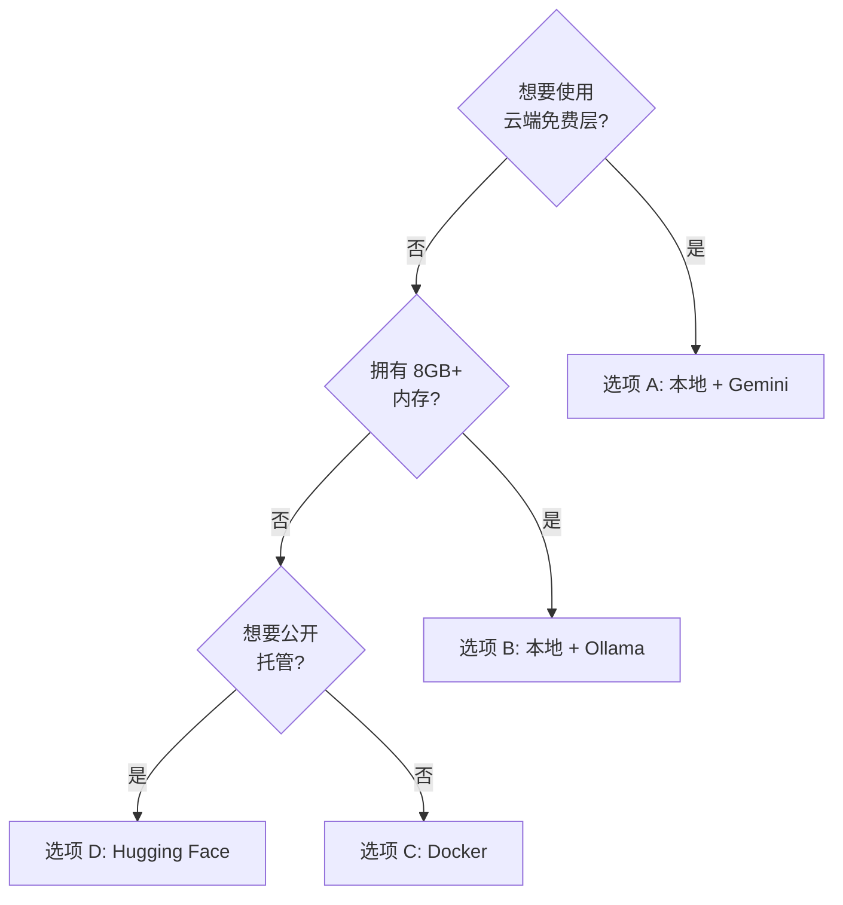
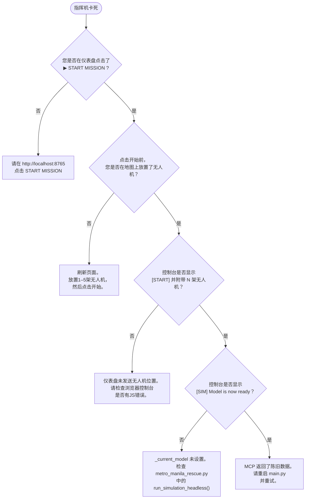
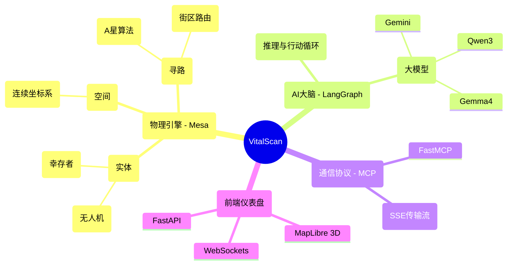

<!-- Compiled Documentation: USER_GUIDE_ZH.md -->

<div align="center">

# ⚙️ 用户指南 (Setup Guide)
### 马尼拉大都会搜索与救援无人机集群

[](https://python.org)
[](https://docker.com)
[](https://huggingface.co/spaces)

</div>

---

## 🗺️ 选择您的安装路径



---

## 环境要求 (Prerequisites)

- **Python 3.13+** — 使用 `python --version` 检查
- **Git** — 用于克隆仓库
- **最低 4 GB 内存** (如果要运行本地大模型，推荐 8 GB)

---

## 选项 A — 本地运行 + Gemini API

最快的启动方式。Gemini 2.5 Flash 提供免费调用额度。

### 1. 克隆与安装

```bash
git clone https://github.com/ngai123/VitalScan.git
cd VitalScan
pip install -r requirements.txt
```

### 2. 获取 Gemini API Key

1. 访问 [aistudio.google.com](https://aistudio.google.com)
2. 点击 **Get API key** → **Create API key**
3. 复制生成的密钥

### 3. 设置密钥

```bash
# macOS / Linux
export GOOGLE_API_KEY='your-key-here'

# Windows (Command Prompt)
set GOOGLE_API_KEY=your-key-here

# Windows (PowerShell)
$env:GOOGLE_API_KEY='your-key-here'
```

### 4. 运行系统

```bash
python main.py --models gemini-2.5-flash
```

### 5. 打开仪表盘 (Dashboard)

在浏览器中访问 **http://localhost:8765**，在地图上放置无人机和幸存者，然后点击 **▶ START MISSION** (开始任务)。

---

## 选项 B — 本地运行 + Ollama (无需 API Key)

使用本地 LLM 完全离线运行。虽然速度不及 Gemini，但完全免费且保护隐私。

### 1. 安装 Ollama

```bash
# macOS
brew install ollama

# Linux
curl -fsSL https://ollama.com/install.sh | sh

# Windows — 从 https://ollama.com 下载安装程序
```

### 2. 拉取模型

```bash
# 推荐 (速度快，需 4 GB 内存)
ollama pull qwen3:4b-instruct

# 性能更强但体积更大 (需 9 GB 内存)
ollama pull qwen3.5:9b
```

### 3. 启动 Ollama

```bash
ollama serve
# 运行于 http://localhost:11434
```

### 4. 克隆与安装

```bash
git clone https://github.com/ngai123/VitalScan.git
cd VitalScan
pip install -r requirements.txt
```

### 5. 运行系统

```bash
python main.py --models qwen3:4b-instruct
```

### 云端与本地模型混合运行

您可以让不同的无人机运行不同的模型：

```bash
python main.py --models gemini-2.5-flash,qwen3:4b-instruct
```

无人机会在模型列表中循环分配——第一架无人机使用模型 1，第二架使用模型 2，以此类推。

---

## 选项 C — Docker 部署

### 1. 构建镜像

```bash
git clone https://github.com/ngai123/VitalScan.git
cd VitalScan
docker build -t metro-manila-rescue .
```

### 2. 运行

```bash
docker run -p 7860:7860 -p 8766:8766 \
  -e GOOGLE_API_KEY='your-key-here' \
  metro-manila-rescue
```

### 3. 打开仪表盘

访问 **http://localhost:7860**

> Docker 镜像使用了 `7860` 端口 (Hugging Face Spaces 的标准端口)。在本地运行时，该端口也会映射为 7860。

---

## 选项 D — Hugging Face Spaces (免费云端托管)

无需服务器成本的公开部署方式。

### 1. 创建 Space

1. 访问 [huggingface.co/new-space](https://huggingface.co/new-space)
2. **Space SDK** → 选择 `Docker`
3. **Visibility** (可见性) → Public (公开) 或 Private (私有)

### 2. 推送代码

```bash
git clone https://github.com/ngai123/VitalScan.git
cd VitalScan

# 添加 HuggingFace 远程仓库
git remote add hf https://huggingface.co/spaces/YOUR_USERNAME/YOUR_SPACE_NAME

# 推送代码
git push hf main
```

### 3. 添加 API Key 为机密变量 (Secret)

1. 进入您的 Space → 点击 **Settings** (设置) → **Repository secrets** (仓库机密)
2. 添加：`GOOGLE_API_KEY` = `your-gemini-key`

HF Spaces 会在运行时自动将机密作为环境变量注入 Docker 容器。

### 4. 等待构建

Space 将自动构建并部署 (约需 2-3 分钟)。访问地址：
`https://huggingface.co/spaces/YOUR_USERNAME/YOUR_SPACE_NAME`

---

## 环境变量参考 (Environment Variables Reference)

| 变量 | 默认值 | 描述 |
|----------|---------|-------------|
| `GOOGLE_API_KEY` | — | **必需** (如果使用 Gemini 模型) |
| `PORT` | `7860` | 仪表盘 HTTP 端口 |
| `MCP_PORT` | `8766` | MCP SSE 服务器端口 |
| `MCP_SERVER_URL` | `http://0.0.0.0:8766` | MCP 服务器 URL (内部) |
| `DASHBOARD_URL` | `http://0.0.0.0:7860` | 仪表盘 URL (内部) |
| `DASHBOARD_AI_URL` | `http://0.0.0.0:7860/api/ai_event` | AI 事件接口端点 |
| `HEADLESS` | `false` | 设置为 `true` 将跳过自动打开浏览器的步骤 |

---

## 命令行接口参考 (CLI Reference)

```
python main.py [--models MODEL_LIST]

参数:
  --models    以逗号分隔的 LLM 模型名称列表。
              各无人机会在列表中循环使用模型。
              默认值: gemini-2.5-flash

示例:
  python main.py --models gemini-2.5-flash
  python main.py --models qwen3:4b-instruct
  python main.py --models gemini-2.5-flash,qwen3:4b-instruct,gemini-2.0-flash
```

---

## 支持的模型 (Supported Models)

| 模型 ID | 供应商 | 是否需要 Key |
|----------|----------|-----------|
| `gemini-2.5-flash` | Google AI | `GOOGLE_API_KEY` |
| `gemini-2.0-flash` | Google AI | `GOOGLE_API_KEY` |
| `gemini-3-flash-preview` | Google AI | `GOOGLE_API_KEY` |
| `qwen3:4b-instruct` | Ollama (本地) | 无 |
| `qwen3.5:9b` | Ollama (本地) | 无 |
| `llama3` | Ollama (本地) | 无 |
| `phi3` | Ollama (本地) | 无 |

---

## 常见安装错误 (Common Setup Errors)

| 错误信息 | 原因 | 修复方法 |
|-------|-------|-----|
| `GOOGLE_API_KEY not set` | 未设置环境变量 | 运行 `export GOOGLE_API_KEY='...'` |
| `Port 8766 already in use` | 端口已被占用 | `main.py` 会自动尝试杀进程；或手动执行 `lsof -ti:8766 \| xargs kill` |
| `Port 8765 already in use` | 同上 | 执行 `lsof -ti:8765 \| xargs kill` |
| `Ollama service not detected` | Ollama 未运行 | 在另一个终端中运行 `ollama serve` |
| `model 'qwen3' not found` | 未下载对应模型 | 执行 `ollama pull qwen3:4b-instruct` |
| `MCP server did not start in time` | 机器运行缓慢 | 在 `main.py` 中增加 `SERVER_READY_TIMEOUT` 的值 |
| 仪表盘加载后白屏 | 尚未开始模拟任务 | 在地图上放置实体并点击 **▶ START MISSION** |

---


<div align="center">

# 🔧 故障排除指南 (Troubleshooting Guide)

</div>

---

## 快速诊断

| 症状 | 跳转至 |
|---------|---------|
| 指挥机永远在提示 "all drones busy — waiting" | [问题 #1](#问题-1--指挥机卡在等待无人机状态) |
| 点击 START MISSION 后地图仍然空白 | [问题 #2](#问题-2--点击-start-mission-后仪表盘空白) |
| Port already in use (端口被占用) 错误 | [问题 #3](#问题-3--端口已被占用) |
| 找不到 Ollama 模型 | [问题 #4](#问题-4--找不到-ollama-模型) |
| 任务开始后无人机不移动 | [问题 #5](#问题-5--无人机不移动) |
| `GOOGLE_API_KEY not set` 错误 | [问题 #6](#问题-6--google_api_key-not-set) |
| MCP server timeout (服务器超时) | [问题 #7](#问题-7--mcp-服务器未能及时启动) |

---

## 常见问题 (Common Issues)

### 问题 #1 — 指挥机卡在等待无人机状态

**症状:**
```
[COMMANDER] Waiting for simulation to initialize with drones...
[COMMANDER] Waiting for simulation to initialize with drones...
  (无限重复)
```

**问题排查流程图:**



---

### 问题 #2 — 点击 START MISSION 后仪表盘空白

**症状:** 地图渲染正常，但点击 Start 后没有任何无人机或幸存者出现。

**检查步骤:**
1. 打开浏览器开发者工具 (DevTools) → Console 标签页 — 检查是否有 WebSocket 错误
2. 确认模拟系统正在运行 (Tick)：控制台应周期性显示 `[SIM]` 输出
3. 确认 MCP 服务器已启动：寻找 `[MCP] MCP server → http://localhost:8766`

**修复方法:** WebSocket 连接可能在页面加载前建立失败。请强制刷新仪表盘页面 (`Cmd+Shift+R` / `Ctrl+Shift+R`) 并再次点击 Start。

---

### 问题 #3 — 端口已被占用 (Port Already in Use)

**症状:**
```
OSError: [Errno 48] Address already in use: ('0.0.0.0', 8766)
```

`main.py` 在启动时会自动使用 `lsof` 尝试关闭 8765 和 8766 端口的进程。如果失败（如在 Windows 上），请手动杀掉进程：

```bash
# macOS / Linux
lsof -ti:8766 | xargs kill -9
lsof -ti:8765 | xargs kill -9

# Windows (PowerShell)
netstat -ano | findstr :8766
taskkill /PID <PID> /F
```

---

### 问题 #4 — 找不到 Ollama 模型

**症状:**
```
❌ [AI] Ollama is running, but model 'qwen3:4b-instruct' was not found.
   → Run: ollama pull qwen3:4b-instruct
```

**修复方法:**
```bash
ollama pull qwen3:4b-instruct
# 然后重启 main.py
```

---

### 问题 #5 — 无人机不移动

**症状:** 任务开始后，仪表盘显示无人机停留在基地，状态一直保持为 `idle`。

**检查内容:**

| 寻找的日志信息 | 含义 |
|----------------|---------|
| `[drone_21] Executed move_drone_to: OK` | 无人机成功收到移动指令 ✅ |
| `[drone_21] Executed move_drone_to: REFUSED` | 电量 ≤ 20% — 必须先召回 |
| `[drone_21] BLOCKED: outside sector` | 目标航点超出了分配的区域 |
| 完全没有 `[drone_21]` 输出 | LLM 没有响应 — 检查 API Key 或 Ollama |

**常见修复:** LLM 没有调用任何工具。请检查：
- `GOOGLE_API_KEY` 是否已设置（如果是 Gemini）
- `ollama serve` 是否正在运行（如果是本地模型）
- `--models` 中的名称是否与支持的模型 ID 完全匹配

---

### 问题 #6 — `GOOGLE_API_KEY not set`

**修复方法:**
```bash
export GOOGLE_API_KEY='your-key-here'
python main.py --models gemini-2.5-flash
```
或者切换为不需要 API 密钥的本地模型：
```bash
python main.py --models qwen3:4b-instruct
```

---

### 问题 #7 — MCP 服务器未能及时启动

**症状:**
```
[SYSTEM] MCP server did not start in time. Check mcp_server.py.
```

**原因:** `mcp_server.py` 的启动时间超过了 30 秒（机器运行缓慢，或依赖项加载慢）。

**修复方法:** 在 `main.py` 中增加超时时间：
```python
SERVER_READY_TIMEOUT = 60  # 原为 30
```

---

<div align="center">

# 📖 词汇表 (Glossary)
### 马尼拉大都会搜索与救援无人机集群

</div>

---

## 🧠 概念导图 (Concept Map)



---

## 📚 核心术语 (Terminology)

| 术语 | 定义 |
|------|------------|
| **A\*** | 网格寻路算法，通常作为 OSRM 失效时的备用方案。 |
| **Arc Formation (弧形编队)** | 以基地为中心，呈 3-2-1 阵型向外辐射的导航策略。 |
| **Base Station (基地站)** | 固定充电枢纽（例如 Roxas Blvd, Intramuros）。 |
| **Battery Drain (电量消耗)** | 恒定的飞行能耗，通过 Haversine 公式计算（每公里消耗 0.5%）。 |
| **Boustrophedon (割草机模式)** | 来回折返的扫描模式，保证 100% 的区域覆盖率。 |
| **Callsign (呼号)** | 指派给无人机的特定角色标识（如 R1, R2, CMD）。 |
| **ContinuousSpace (连续空间)** | Mesa 环境，允许智能体使用真实的浮点 GPS 坐标。 |
| **FastAPI** | 提供后端与 Dashboard 网页服务的 Python Web 框架 (端口 8765)。 |
| **FastMCP** | 定义 SSE 工具的 Python 库 (端口 8766)。 |
| **GeoJSON** | 用于地理映射的 JSON 格式（例如 OSRM 路径响应）。 |
| **Haversine** | 球面公式，用于计算真实地球表面两点间的 GPS 距离。 |
| **LangGraph / LLM** | 智能体框架，利用大语言模型 (LLM) 管理 ReAct 逻辑循环。 |
| **MCP** | 模型上下文协议 (Model Context Protocol) — 大模型调用工具的标准 API 格式。 |
| **Mesa** | 运行核心物理模拟循环的 Python 框架。 |
| **Ollama** | 本地 LLM 服务器，用于运行如 Qwen3 和 Gemma4 的模型。 |
| **OSRM** | 开放街道路由 API，为无人机提供高逼真度的物理路线规划。 |
| **ReAct** | 推理与行动 (Reasoning + Acting)：大模型思考然后调用工具的循环模式。 |
| **Ring Swap (层级替换)** | 一种物理协议：当外圈无人机电量耗尽时，中间圈的无人机会自动前往替换。 |
| **Semaphore (信号量)** | 异步锁机制，防止过度调用压垮 API 连接。 |
| **SSE** | Server-Sent Events 流；处理异步工具通信。 |
| **Team Sector Sweep (编队扇区扫描)** | 5架无人机共同收敛，专注搜索一个 72° 的扇形扇区。 |
| **Thermal Scan (热成像扫描)** | 模拟探测半径 100m 内的红外幸存者信号。 |
| **X-Ray Console (X光指挥台)** | 前端界面面板，实时流式输出大模型的思维链过程。 |
